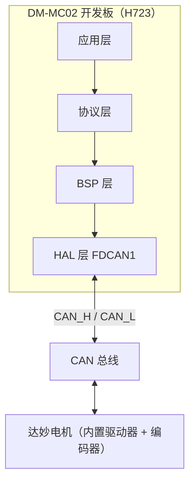
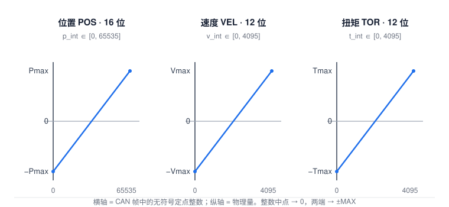
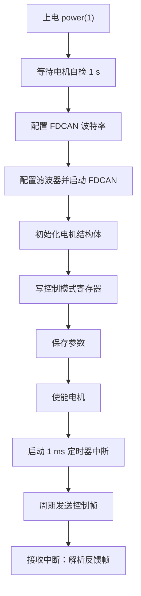

---
tags:
  - motor-control
  - FDCAN
  - STM32
  - DM-MC02
  - 达妙电机
date: 2026-10-09
source: https://gl1po2nscb.feishu.cn/wiki/VYrlwHI7liHzXIkx0s0cUOVdnzb
---

# 使用 DM-MC02(H723) 开发板驱动达妙电机

> **一句话**：把 DM-MC02(H723) 当成 CAN 主站——用它的 **FDCAN1** 外设向达妙电机发送控制帧、接收反馈帧，从而以 **MIT / 位置速度 / 速度 / 力位混控** 四种模式驱动电机。

> [!NOTE]
> **关于本文**
> 本文由飞书文档《2. 达妙电机上手流程(二)-使用开发板控制电机》整理、重组、补充而成：**C 代码与协议帧格式忠实保留原文**；章节顺序、参数表、流程图、换算示例为便于理解而重新编排，并在若干处补注了原文的笔误。源文档链接见文末参考资料。
>
> **§3.1~§3.4 的「工程结构与 CubeMX 图形界面操作」为本文补充内容**：原文只给了 FDCAN 参数界面截图，没有交代工程怎么来、文件放哪、图形界面怎么点。这部分由源文档线索（参考工程名 `CrBoard.ioc`、例程地址、代码注释里出现的文件与函数）结合 STM32CubeMX 的通用操作流程补齐；凡需按你手上例程核对的，文中都标注了。

---

## 0. 章节地图：每一章在解决什么问题

整套控制可以拆成四层，前面再加上一层「工程搭建」。五层全部打通，电机才会转。

| 层次 | 对应章节 | 回答的问题 |
|---|---|---|
| 工程搭建层 | §1 硬件与工具 · §3.1~§3.4 工程结构与 CubeMX 操作 | 工程从哪来、文件放在哪、图形界面怎么点、哪些代码会被覆盖 |
| 链路 / 物理层 | §3.5 参考配置 · §4 波特率与采样点 · §5 滤波器 · §6 发送 · §7 接收 | 开发板怎么把一串字节发到总线上、又怎么把它收回来 |
| 应用协议层 | §8 电机底层控制协议 | 这 8 个字节代表什么含义（位置 / 速度 / 力矩 / 使能） |
| 设备配置层 | §9 寄存器读写 | 怎么改电机自身的参数（控制模式、CAN ID、波特率、量程） |
| 集成层 | §10 实战 | 把上面三层串起来，让电机真正转起来 |

### 为什么必须先讲 FDCAN？

1. **它是唯一的通道。** 达妙电机只认 CAN 报文，而开发板这一侧对应的外设就是 FDCAN。CAN 不通，后面的帧格式、控制模式、实战全都无从谈起。
2. **它最容易卡住新手。** 波特率与采样点必须和电机内部设定一致；滤波器配错就收不到数据；FIFO/时序配错就收不全。第一次上手，绝大多数问题都出在这一层。
3. **它决定了协议的样子。** 例如反馈帧把「CAN ID」和「状态位」塞进同一个字节 D[0]，才导致后面「CAN ID 不能大于 15」这条硬约束——不理解帧结构，就理解不了这条限制。

### 推荐阅读顺序

```text
§1 前置条件 → §2 数据流 → §3.1~§3.4 把工程搭起来 → §3.5~§7 打通收发 → §8 协议 → §9 配置电机 → §10 实战
```

任何一步出现「发不出去 / 收不到 / 电机不动」，都回到 §3.5~§7 排查链路。如果连编译或下载都过不去，那问题在 §3.3~§3.4 的工程配置，不在 CAN。

---

## 1. 前置条件与硬件清单

| 项目 | 说明 |
|---|---|
| 开发板 | **DM-MC02(H723)**（STM32H723VGTx），CAN 外设使用 **FDCAN1** |
| 调试器 | USB 转 CAN 模块 + 上位机（原文使用 USB2CAN），用于抓总线、验证收发 |
| 电机 | 达妙（DM）系列电机，示例为 **DM4310**，驱动器内置于电机 |
| 例程 | 官方 STM32 例程（源文档给出）：`gitee.com/kit-miao/motor-control-routine` 下的 `stm32例程` 目录；本文参考工程为其中的 `CrBoard.ioc` |
| 软件 | **STM32CubeMX**（配外设、生成工程）+ **Keil MDK-ARM**（含 **STM32H7xx_DFP** 器件支持包）+ **USB 转 CAN 上位机**（抓总线、验证收发） |
| 电源 | 开发板可控电源接口（代码中 `power(1)` 打开），给电机上电并等待自检 |

> [!WARNING]
> **供电红线**
> MC 开发板**最高仅支持 24 V**，禁止接入 28 V 以上电源，**过压会直接烧毁开发板**。
> 如需用开发板控制 48 V 电机，请**分开供电**（控制侧与功率侧独立）。

---

## 2. 整体数据流

开发板是**主站**，电机是**从站**：开发板发控制帧，电机回反馈帧。两者的搬运工就是 CAN 总线。



| 层 | 职责 | 关键函数 / 对象 | 落在工程里哪个文件 |
|---|---|---|---|
| 应用层 | 写目标值、读反馈值 | `motor[Motor1].ctrl`、`motor[Motor1].para` | `main.c`（USER CODE 区） |
| 协议层 | 按所选模式把目标值打包成帧、解析反馈帧 | `dm_motor_ctrl_send`、`dm_motor_fbdata` | `dm_motor_ctrl.c`（手写） |
| BSP 层 | 波特率、滤波器、收发的封装 | `bsp_fdcan_set_baud`、`can_filter_init`、`fdcanx_send_data`、`fdcanx_receive` | `bsp_can.c`（手写） |
| HAL 层 | STM32 外设驱动 | `FDCAN1`（`hfdcan1`） | `Drivers/STM32H7xx_HAL_Driver/`（官方库） |

这四层各自落在哪个目录、由谁生成、什么时候会被覆盖，见 §3.2。

**每一次控制的最小闭环**：

1. 应用层把目标值（位置/速度/力矩）写进 `motor->ctrl`；
2. 协议层按所选模式把目标值打包成 8 字节（或 4 字节）CAN 帧；
3. BSP 层把帧交给 FDCAN1 发上总线；
4. 电机执行并周期性回传反馈帧；
5. 接收中断解析反馈帧，更新 `motor->para`（当前位置/速度/力矩/温度/状态）。

---

## 3. 工程搭建：从 CubeMX 到能编译的工程

§2 那张图回答的是「数据要经过哪几层」，这一章解决更靠前的问题：**这些代码放在哪个工程里、工程从哪来、CubeMX 的图形界面要点哪几下、哪些文件重生成后会被覆盖**。这一章不打通，§4 之后的内容就只是一堆没有容器的代码片段。

### 3.1 三种起点，先选一条

先对号入座，起点不同，接下来要动的东西差别很大：

| 起点 | 适合谁 | 怎么做 | 代价 |
|---|---|---|---|
| **A. 直接跑官方例程**（第一次上手推荐） | 只想先让电机转起来 | 下载 STM32 例程，用 Keil 打开 `MDK-ARM` 下的 `.uvprojx`，照 §10 改几行参数，编译下载 | 最快；但跑通前不必懂每一处配置 |
| **B. 拿参考工程的配置做自己的工程** | 想留一份自己的工程，又不想从零点开始 | 复制一份参考工程目录 → 双击 `.ioc` 打开 CubeMX → 改工程名 / 时钟 / 引脚 → `GENERATE CODE` | 需要先弄懂 §3.4 的覆盖规则 |
| **C. 从零用 CubeMX 新建** | 想真正搞懂每一处配置 | 按 §3.3 的图形界面步骤走一遍 | 最慢，但踩过的坑记得最牢 |

例程仓库（源文档给出的链接）：[motor-control-routine](https://gitee.com/kit-miao/motor-control-routine)，STM32 部分在 `stm32例程` 目录下；本文 §3.5 的参数表转录自其中的参考工程 `CrBoard.ioc`。

> [!TIP]
> **拿到例程先原样编译一次**
> 第一件事不是改代码，而是**不改任何东西编译下载一次**。如果例程本身都跑不起来，问题在工具链或硬件（Keil 是否装了 STM32H7xx_DFP 器件包、调试器、供电、接线），不在 CAN 配置。这一步能把「环境问题」和「CAN 问题」分开，省掉大量误判。

### 3.2 工程结构：文件都在哪、各管什么

CubeMX 生成的骨架是固定的，**变的是你往里加的那几个驱动文件**。下面这棵树把「生成的」和「手写的」分开标注：

```text
CrBoard/                        ← 工程根目录（名字取自参考工程，你可以另起）
├── CrBoard.ioc                 ← ★ CubeMX 图形配置的存档，双击它回到界面（见 §3.4）
├── .mxproject                  ← CubeMX 自动记录，不用管
│
├── Core/                       ← CubeMX 生成：外设初始化与中断
│   ├── Inc/
│   │   ├── main.h
│   │   ├── fdcan.h / tim.h / gpio.h   ← 外设句柄声明：hfdcan1、htim3 …
│   │   └── stm32h7xx_hal_conf.h       ← HAL 模块开关
│   └── Src/
│       ├── main.c                     ← 你的业务入口：§10.0 那段初始化序列写这里
│       ├── fdcan.c / tim.c / gpio.c   ← MX_FDCAN1_Init()、MX_TIM3_Init() …
│       ├── stm32h7xx_it.c             ← 中断入口：FDCAN1_IT0_IRQHandler、TIM3_IRQHandler
│       └── stm32h7xx_hal_msp.c        ← 引脚与时钟使能（HAL_FDCAN_MspInit）
│
├── Drivers/                    ← CubeMX 生成：ST 官方库
│   ├── CMSIS/                         ← 内核与 H7 寄存器定义
│   └── STM32H7xx_HAL_Driver/          ← HAL_FDCAN_xxx 就在这里
│
├── bsp_can.c / bsp_can.h       ← ★ 手写：BSP 层（§2 表里的「BSP 层」）
│       bsp_fdcan_set_baud()     重设波特率与时序（§4.5）
│       can_filter_init()        装滤波器（§5.2）
│       bsp_can_init()           滤波器 + 启动，供 main 调用（§10.0）
│       fdcanx_send_data()       发帧（§6.2）
│       fdcanx_receive()         收帧（§7.2）
│       fdcan1_rx_callback()     收到帧后往协议层抛（§10.0）
│
├── dm_motor_ctrl.c / .h        ← ★ 手写：达妙协议层（§2 表里的「协议层」）
│       dm_motor_init()          电机对象初始化（§10.0）
│       dm_motor_ctrl_send()     按模式打包并发送（§8）
│       dm_motor_fbdata()        解析反馈帧（§8.1）
│       write_motor_data()       写寄存器（§9.4）
│       save_motor_data()        保存参数（§9.5）
│       read_all_motor_data()    读回全部参数（§9.3）
│       motor[]                  电机对象数组，Motor1 是 0 号
│
└── MDK-ARM/                    ← Keil 工程与编译产物
    ├── CrBoard.uvprojx                ← 双击这个打开 Keil
    └── Objects/ Listings/ …            ← 编译输出，不必提交
```

图例：**★ = 需要你改动的文件**；未标注的 = CubeMX 生成，重新 `GENERATE CODE` 会被覆盖。

> [!WARNING]
> **文件名以你手上的例程为准**
> 例程实际目录名可能不同（`bsp_can.c` 可能放在 `BSP/` 或 `Drivers/BSP/` 下，协议文件也可能拆成几个）。**不要照本文的树去改路径**——它说明的是「有这几类文件、各自管什么」。三十秒确认自己工程结构的办法：在 Keil 左侧 Project 窗口看分组（Groups），那本身就是工程结构。

**改动落点速查**（比目录树更常用）：

| 你要做的事 | 该动哪里 | 会被 CubeMX 覆盖吗 |
|---|---|---|
| 改 FDCAN 的引脚、时钟、时序参数 | 回 CubeMX 改 `.ioc` → `GENERATE CODE`（§3.3） | 是，这正是它的职责 |
| 再开一个外设（例如第二个定时器） | 同上，在 CubeMX 里加 | 是 |
| 改波特率档位、滤波器、收发封装 | `bsp_can.c`（手写文件） | 不会 |
| 改控制模式、目标值、使能逻辑 | `dm_motor_ctrl.c` + `main.c` 的 USER CODE 区 | 不会（`main.c` 区内安全，区外会被覆盖） |
| 写自己的业务（例如让它恒速转） | `main.c` 的 `/* USER CODE BEGIN */` … `/* USER CODE END */` | 不会 |

### 3.3 STM32CubeMX 图形界面操作流程（从零建工程）

CubeMX 的配置全在图形界面完成，最终**存成一个 `.ioc` 文件**。下面按界面顺序走一遍，只列与本项目相关的项。

**第 0 步 · 新建或打开**

- 新建：`File > New Project` → 切到 `MCU/MPU Selector` → 搜 `STM32H723VGTx` → 双击 → `Start Project`
- 打开已有配置：直接双击工程里的 `.ioc`（这就是 §3.1 起点 B 的做法）

**第 1 步 · Pinout & Configuration（左侧分类，自上而下配）**

| 界面位置 | 配什么 | 取值 / 说明 |
|---|---|---|
| `System Core > RCC` | High Speed Clock (HSE) | `Crystal/Ceramic Resonator`（板上是外部晶振） |
| `System Core > SYS` | Debug | `Serial Wire` —— **必做**；不选会在下载一次后关掉 SWD，之后再也连不上板子 |
| `Connectivity > FDCAN1` | 帧格式、模式、位时序 | 逐项照 §3.5 的表填；右侧 Pinout 视图会把 FDCAN1_RX / TX 引脚自动标绿（具体引脚号以参考工程或开发板原理图为准） |
| `FDCAN1 > NVIC Settings` | 接收中断 | 勾上 FDCAN1 中断，否则收到帧也进不了回调（§7.3） |
| `Timers > TIM3` | 控制周期 | Clock Source = `Internal Clock`，参数配成 **1 ms** 周期；NVIC 里勾 TIM3 global interrupt —— 例程用它当「每毫秒发一帧」的心跳（§10.0） |
| `System Core > GPIO` | 开发板可控电源 | 配一个输出脚，对应例程里的 `power(1)` |

**第 2 步 · Clock Configuration（时钟树）**

这一步直接决定 §4 的波特率能不能对上，是最容易配错的地方：

1. HSE 填板子晶振频率，配 PLL 得到 CPU / 总线时钟；
2. 找到 **FDCAN 的内核时钟**（CubeMX 用不同底色标出每个外设取哪路时钟），把它配成 **80 MHz**——本文 §4.1 的自检与 §4.5 的代码全部按 80 MHz 写；
3. 页面下方会直接显示各路的实际频率，**以它显示的数为准**，别凭 PLL 参数心算。

> [!IMPORTANT]
> **判定标准就一条：FDCAN 内核时钟 = 80 MHz**
> 如果你为了别的外设改了时钟树，却没同步改 FDCAN 的分频/时序，实际波特率就不再是 1 Mbit/s，而电机的 `can_br` 还停在 1M —— 现象是「代码没报错、总线上什么都没有」。改完用 §4.1 的公式反算一遍即可确认。

**第 3 步 · Project Manager（生成前的最后一步）**

| 页面 | 项 | 建议值 |
|---|---|---|
| `Project` | Project Name / Location | 自己起名；路径**不要有中文和空格** |
| `Project` | Toolchain/IDE | `MDK-ARM`（Keil）；用别的 IDE 就选对应的 |
| `Code Generator` | Generate peripheral initialization as a pair of .c/.h files | **勾上**。这样每个外设一个文件（`fdcan.c`、`tim.c`）；不勾则全部堆进 `main.c` |
| `Code Generator` | Copy only the necessary library files | 勾上，省空间 |

**第 4 步 · GENERATE CODE**

点右上角 `GENERATE CODE`，生成 `Core/`、`Drivers/`、`MDK-ARM/` 和 `.ioc`。然后：

1. 打开 `MDK-ARM/` 下的 `.uvprojx`；
2. **原样编译一次**，确认 0 error，证明器件包与工程骨架没问题；
3. 再按 §3.2 的表把手写的 BSP / 协议文件加进工程（Keil 里右键分组 → Add Existing Files）。

**第 5 步 · 编译、下载、看现象**

1. `Options for Target > Debug` 选你的调试器（ST-Link / J-Link / CMSIS-DAP），`Utilities > Settings` 里勾上 `Reset and Run`；
2. 编译 → 下载；
3. 两处看现象，缺一不可：**USB 转 CAN 上位机**看总线上有没有报文，**Keil 的 Watch 窗口**看 `motor[Motor1].para` 有没有更新（§10 每种模式末尾都写了这一步）。

### 3.4 `.ioc` 文件：配置的存档，以及「哪些代码会被覆盖」

**`.ioc` 是什么**：它不是代码，而是一份**配置清单**——记录选了哪颗芯片、每个引脚干什么、时钟树怎么分、每个外设的参数、以及生成代码的选项。本质上是个文本文件，可以直接用记事本打开看。

- **它是配置的唯一真源。** 任何时候双击它就能恢复整套图形配置，改完再点一次 `GENERATE CODE`。**不要手工编辑它的内容**，要改就回图形界面。
- **它要跟着工程一起提交。** 少了它，别人拿到的只是一堆生成出来的代码，配置改不了。同理 `Core/`、`Drivers/`、`.mxproject` 一起提交；`MDK-ARM/Objects` 之类编译产物不必提交。

**生成的文件会被重写——这是新手最容易丢代码的地方。**

每次 `GENERATE CODE` 都会覆盖 `Core/` 与 `Drivers/` 里的生成文件。CubeMX 在这些文件里留了保护区，**自己写的代码只能写在保护区之间**：

```c
/* USER CODE BEGIN 2 */
  // 你写的代码放这里：重新 GENERATE CODE 也不会丢
  bsp_fdcan_set_baud(&hfdcan1, CAN_CLASS, CAN_BR_1M);
  bsp_can_init();
/* USER CODE END 2 */
```

保护区成对出现（`BEGIN 2` 配 `END 2`），`main.c`、`fdcan.c` 里都有对应段落。照抄例程代码时，**先认区号再粘贴**。

> [!WARNING]
> **两条必须记住的边界**
> 1. 写在 `/* USER CODE BEGIN */` 与 `/* USER CODE END */` **之外**的自定义代码，会在下一次 `GENERATE CODE` 时被**静默覆盖**，没有任何提示。
> 2. 所以自己的驱动（`bsp_can.c`、`dm_motor_ctrl.c`）要**独立成文件**，不要塞进 `main.c` 或 `fdcan.c` 的生成区；独立文件 CubeMX 不会碰。

> [!NOTE]
> **图形界面配的是「上电初值」**
> 例程在 `main()` 里还会用 `bsp_fdcan_set_baud()` 把波特率与时序重设一遍（见 §3.5 表后的说明）。所以改波特率时，**CubeMX 里的值和 BSP 里的值要同时对上**；只改一处会出现「编译没问题、通信对不上」的现象。

### 3.5 FDCAN1 参考配置（以 DM-MC02(H723) 为例）

参考工程 `CrBoard.ioc` / `STM32H723VGTx` 的 FDCAN1 参数界面，逐项转录如下（**参数名以你所用 CubeMX 版本为准，取值以参考工程为准**；源文档此处的界面截图未随文保留，因此以参数表为准）：

| 参数 | 取值 |
|---|---|
| Frame Format | `FD mode with BitRate Switching` |
| Mode | `Normal mode` |
| Auto Retransmission | Enable |
| Transmit Pause | Disable |
| Protocol Exception | Disable |
| Nominal Sync Jump Width | 20 |
| Data Prescaler | 1 |
| Data Sync Jump Width | 2 |
| Data Time Seg1 | 13 |
| Data Time Seg2 | 2 |
| Message RAM Offset | 0 |
| Std Filters Nbr | 4 |
| Ext Filters Nbr | 4 |
| Rx FIFO0 Elmt Size | 8 bytes data field |
| Rx FIFO0 Elmts Nbr | 10 |
| Rx FIFO1 Elmt Size | 8 bytes data field |
| Rx FIFO1 Elmts Nbr | 2 |
| Rx Buffers Nbr | 2 |
| Rx Buffers Size | 8 bytes data field |
| Tx Events Nbr | 10 |
| Tx Buffers Nbr | 10 |
| Tx FIFO Queue Elmt Size | 8 bytes data field |
| Tx FIFO Queue Mode | `FIFO mode` |
| Tx Elmt Size | 8 bytes data field |
| Clock Calibration | Disable |
| Nominal Prescaler | 1 |
| Nominal Time Quantum | 12.5 ns |
| Nominal Time Seg1 | 59 |
| Nominal Time Seg2 | 20 |
| Nominal Time for one Bit | 1000 ns |
| Nominal Baud Rate | 1000000 bit/s |

**这组值自检**（CAN 时钟 80 MHz）：

- 标称段： $80\text{M} / 1 / (1+59+20) = 1\ \text{Mbit/s}$
- 采样点： $(1+59)/80 = 0.75$ ✅（即 75%）
- 时间量： $1/80\text{M} = 12.5\ \text{ns}$ ✅

> [!NOTE]
> **为什么代码里还要重设一次**
> 实战例程在 `main()` 里还会调用 `bsp_fdcan_set_baud(&hfdcan1, CAN_CLASS, CAN_BR_1M)`，把 `FrameFormat` 改成**经典 CAN** 并重设分频/时序（`HAL_FDCAN_DeInit` → 改 `Init` → `HAL_FDCAN_Init`）。也就是说 CubeMX 里配的是**上电初值**，真正生效的是 BSP 里那一段。改波特率时，**两处都要对得上**。

### 3.6 各配置参数详细说明

**Frame Format** —— CAN 帧格式

```c
#define FDCAN_FRAME_CLASSIC      ((uint32_t)0x00000000U)                  /* 经典 CAN 模式 */
#define FDCAN_FRAME_FD_NO_BRS    ((uint32_t)FDCAN_CCCR_FDOE)              /* FD CAN 不带可变波特率 */
#define FDCAN_FRAME_FD_BRS       ((uint32_t)(FDCAN_CCCR_FDOE|FDCAN_CCCR_BRSE)) /* FD CAN 带可变波特率 */
```

**Mode** —— 操作模式

```c
#define FDCAN_MODE_NORMAL               ((uint32_t)0x00000000U) /* 正常模式 */
#define FDCAN_MODE_RESTRICTED_OPERATION ((uint32_t)0x00000001U) /* 有限制的操作模式 */
#define FDCAN_MODE_BUS_MONITORING       ((uint32_t)0x00000002U) /* 总线监测模式 */
#define FDCAN_MODE_INTERNAL_LOOPBACK    ((uint32_t)0x00000003U) /* 内部环回模式 */
#define FDCAN_MODE_EXTERNAL_LOOPBACK    ((uint32_t)0x00000004U) /* 外部环回模式 */
```

**其余参数一览**：

| 参数 | 含义 | 范围 / 取值 |
|---|---|---|
| AutoRetransmission | 自动重发 | Enable / Disable |
| TransmitPause | 传输暂停 | Enable / Disable |
| ProtocolException | 协议异常管理 | Enable / Disable |
| NominalPrescaler | 仲裁段分频 | 1 – 512 |
| NominalSyncJumpWidth | 仲裁段再同步跳变宽度 | 1 – 128 |
| NominalTimeSeg1 | 仲裁段 Bit Segment 1 | 2 – 256 |
| NominalTimeSeg2 | 仲裁段 Bit Segment 2 | 2 – 128 |
| DataPrescaler | 数据段分频 | 1 – 32 |
| DataSyncJumpWidth | 数据段再同步跳变宽度 | 1 – 16 |
| DataTimeSeg1 | 数据段 Bit Segment 1 | 1 – 32 |
| DataTimeSeg2 | 数据段 Bit Segment 2 | 1 – 16 |
| MessageRAMOffset | 消息 RAM 起始地址 | 0 – 2560 |
| StdFiltersNbr | 标准 ID 过滤器个数 | 0 – 128 |
| ExtFiltersNbr | 扩展 ID 过滤器个数 | 0 – 64 |
| RxFifo0ElmtsNbr | RX FIFO0 元素个数 | 0 – 64 |
| RxFifo0ElmtSize | RX FIFO0 每元素数据大小 | 见下表 `FDCAN_DATA_BYTES_*` |
| RxFifo1ElmtsNbr | RX FIFO1 元素个数 | 0 – 64 |
| RxFifo1ElmtSize | RX FIFO1 每元素数据大小 | 同上 |
| RxBuffersNbr | Rx Buffer 元素个数 | 0 – 64 |
| RxBuffersSize | Rx Buffer 每元素数据大小 | 同上 |
| TxEventsNbr | Tx Event FIFO 元素个数 | 0 – 32 |
| TxBuffersNbr | 专用 Tx Buffer 元素个数 | 0 – 32 |
| TxFifoQueueElmtsNbr | 用于 Tx FIFO/Queue 的 Tx Buffer 个数 | 0 – 32 |
| TxFifoQueueMode | FIFO 模式 / Queue 队列模式 | 见下 |
| TxElmtSize | Tx Element 数据域大小 | 见下表 |

**数据域大小宏**（Rx FIFO0/FIFO1、Rx Buffer、Tx Element 通用）：

```c
#define FDCAN_DATA_BYTES_8  ((uint32_t)0x00000004U) /*!< 8  bytes data field */
#define FDCAN_DATA_BYTES_12 ((uint32_t)0x00000005U) /*!< 12 bytes data field */
#define FDCAN_DATA_BYTES_16 ((uint32_t)0x00000006U) /*!< 16 bytes data field */
#define FDCAN_DATA_BYTES_20 ((uint32_t)0x00000007U) /*!< 20 bytes data field */
#define FDCAN_DATA_BYTES_24 ((uint32_t)0x00000008U) /*!< 24 bytes data field */
#define FDCAN_DATA_BYTES_32 ((uint32_t)0x0000000AU) /*!< 32 bytes data field */
#define FDCAN_DATA_BYTES_48 ((uint32_t)0x0000000EU) /*!< 48 bytes data field */
#define FDCAN_DATA_BYTES_64 ((uint32_t)0x00000012U) /*!< 64 bytes data field */
```

**Tx FIFO / Queue 模式**：

```c
#define FDCAN_TX_FIFO_OPERATION  ((uint32_t)0x00000000U)      /*!< FIFO 模式 */
#define FDCAN_TX_QUEUE_OPERATION ((uint32_t)FDCAN_TXBC_TFQM)  /*!< Queue 队列模式 */
```

---

## 4. 波特率与采样点

### 4.1 计算公式（CAN 时钟取 80 MHz）

下面用 $B$ 表示波特率（单位 bit/s）， $S$ 表示采样点比例；公式里的 $\text{NominalPrescaler}$ 和 $\text{NominalTimeSeg1}$ 等符号，就是 CubeMX 界面上的字段名。

**仲裁段（Nominal）**

$$
B_{\text{nominal}}=\frac{80\text{M}}{\text{NominalPrescaler}\times(1+\text{NominalTimeSeg1}+\text{NominalTimeSeg2})}
$$

$$
S_{\text{nominal}}=\frac{1+\text{NominalTimeSeg1}}{1+\text{NominalTimeSeg1}+\text{NominalTimeSeg2}}
$$

**数据段（Data）**

$$
B_{\text{data}}=\frac{80\text{M}}{\text{DataPrescaler}\times(1+\text{DataTimeSeg1}+\text{DataTimeSeg2})}
$$

$$
S_{\text{data}}=\frac{1+\text{DataTimeSeg1}}{1+\text{DataTimeSeg1}+\text{DataTimeSeg2}}
$$

> [!NOTE]
> **与原文的一处出入**
> 原文把采样点公式的分母写成 `1+Seg1+SyncJumpWidth`。本文改用上面以 **Seg2** 为准的标准写法。因为下文 BSP 代码中恒有 **SJW = TSEG2**（这正是「SJW 应尽量大、与 TSEG2 保持一致」的做法），两种写法在本文所有配置上结果完全相同；但一般定义以 TSEG2 为准。

### 4.2 波特率推荐设置（原文 6 条）

1. **BRP 尽量小**，让 $T_q$ 尽可能小，减少累积误差；
2. CAN FD 推荐 **仲裁域 BRP ≤ 数据域 BRP**；
3. **SJW 尽量大**，尽量与 TSEG2 一致，以提高位宽容忍度；
4. **采样点推荐范围 75% ~ 87.5%**（分档见下）；
5. 总线上**所有节点采样点应尽量一致**；CAN FD 的仲裁域与数据域采样点不要求一致；
6. **CAN FD 数据域波特率 : 仲裁域波特率 应大于 1/8**。

### 4.3 采样点分档

| 波特率 | 推荐采样点 |
|---|---|
| > 800 kbps | 75% |
| > 500 kbps | 80% |
| ≤ 500 kbps | 87.5% |

### 4.4 CAN 波特率计算小工具

原文附了一个 `BitrateTool.exe`（见文末参考资料中的飞书链接）。它只是把上面两条公式做成小工具，**不必依赖它**——下面的表已经把所有常用档位列好了。

### 4.5 BSP 代码：`bsp_fdcan_set_baud`

```c
#define CAN_CLASS   0    // 经典CAN
#define CAN_FD_BRS  1    // FDCAN

#define CAN_BR_125K 0
#define CAN_BR_200K 1
#define CAN_BR_250K 2
#define CAN_BR_500K 3
#define CAN_BR_1M   4
#define CAN_BR_2M   5
#define CAN_BR_2M5  6
#define CAN_BR_3M2  7
#define CAN_BR_4M   8
#define CAN_BR_5M   9

void bsp_fdcan_set_baud(hcan_t *hfdcan, uint8_t mode, uint8_t baud)
{
    uint32_t nom_brp=0, nom_seg1=0, nom_seg2=0, nom_sjw=0;
    uint32_t dat_brp=0, dat_seg1=0, dat_seg2=0, dat_sjw=0;

    /*      nominal_baud = 80M/brp/(1+seg1+seg2)
            sample point = (1+seg1)/(1+seg1+sjw)  */
    if(mode == CAN_CLASS)
    {
        switch (baud)
        {
            case CAN_BR_125K:         nom_brp=4 ; nom_seg1=139; nom_seg2=20; nom_sjw=20; break; // sample point 87.5%
            case CAN_BR_200K:         nom_brp=2 ; nom_seg1=174; nom_seg2=25; nom_sjw=25; break; // sample point 87.5%
            case CAN_BR_250K:         nom_brp=2 ; nom_seg1=139; nom_seg2=20; nom_sjw=20; break; // sample point 87.5%
            case CAN_BR_500K:         nom_brp=1 ; nom_seg1=139; nom_seg2=20; nom_sjw=20; break; // sample point 87.5%
            case CAN_BR_1M:           nom_brp=1 ; nom_seg1=59 ; nom_seg2=20; nom_sjw=20; break; // sample point 75%
        }
        dat_brp=1 ; dat_seg1=29; dat_seg2=10; dat_sjw=10;        // 数据域默认1M
        hfdcan->Init.FrameFormat = FDCAN_FRAME_CLASSIC;
    }
    /*      data_baud         = 80M/brp/(1+seg1+seg2)
            sample point = (1+seg1)/(1+seg1+sjw)  */
    if(mode == CAN_FD_BRS)
    {
        switch (baud)
        {
            case CAN_BR_2M:           dat_brp=1 ; dat_seg1=29; dat_seg2=10; dat_sjw=10; break;   // sample point 75%
            case CAN_BR_2M5:          dat_brp=1 ; dat_seg1=25; dat_seg2=6 ; dat_sjw=6 ; break;   // sample point 81.25%
            case CAN_BR_3M2:          dat_brp=1 ; dat_seg1=19; dat_seg2=5 ; dat_sjw=5 ; break;   // sample point 80%
            case CAN_BR_4M:           dat_brp=1 ; dat_seg1=14; dat_seg2=5 ; dat_sjw=5 ; break;   // sample point 75%
            case CAN_BR_5M:           dat_brp=1 ; dat_seg1=13; dat_seg2=2 ; dat_sjw=2 ; break;   // sample point 87.5%
        }
        nom_brp=1 ; nom_seg1=59 ; nom_seg2=20; nom_sjw=20; // 仲裁域默认1M
        hfdcan->Init.FrameFormat = FDCAN_FRAME_FD_BRS;
    }

    HAL_FDCAN_DeInit(hfdcan);

    hfdcan->Init.NominalPrescaler     = nom_brp;
    hfdcan->Init.NominalTimeSeg1      = nom_seg1;
    hfdcan->Init.NominalTimeSeg2      = nom_seg2;
    hfdcan->Init.NominalSyncJumpWidth = nom_sjw;

    hfdcan->Init.DataPrescaler        = dat_brp;
    hfdcan->Init.DataTimeSeg1         = dat_seg1;
    hfdcan->Init.DataTimeSeg2         = dat_seg2;
    hfdcan->Init.DataSyncJumpWidth    = dat_sjw;

    HAL_FDCAN_Init(hfdcan);
}
```

把 `switch` 里的参数逐条代回公式，结果如下（**已逐项核算**）：

| 模式 | 档位 | BRP | Seg1 | Seg2 | SJW | 采样点 | 实得波特率 |
|---|---|---|---|---|---|---|---|
| 经典 CAN | 125K | 4 | 139 | 20 | 20 | 87.5% | 125 kbit/s ✅ |
| 经典 CAN | 200K | 2 | 174 | 25 | 25 | 87.5% | 200 kbit/s ✅ |
| 经典 CAN | 250K | 2 | 139 | 20 | 20 | 87.5% | 250 kbit/s ✅ |
| 经典 CAN | 500K | 1 | 139 | 20 | 20 | 87.5% | 500 kbit/s ✅ |
| 经典 CAN | 1M | 1 | 59 | 20 | 20 | 75% | 1 Mbit/s ✅ |
| 经典 CAN | 数据域默认 | 1 | 29 | 10 | 10 | 75% | **2 Mbit/s** ⚠️ |
| FDCAN | 仲裁域默认 | 1 | 59 | 20 | 20 | 75% | 1 Mbit/s ✅ |
| FDCAN | 2M | 1 | 29 | 10 | 10 | 75% | 2 Mbit/s ✅ |
| FDCAN | 2M5 | 1 | 25 | 6 | 6 | 81.25% | 2.5 Mbit/s ✅ |
| FDCAN | 3M2 | 1 | 19 | 5 | 5 | 80% | 3.2 Mbit/s ✅ |
| FDCAN | 4M | 1 | 14 | 5 | 5 | 75% | 4 Mbit/s ✅ |
| FDCAN | 5M | 1 | 13 | 2 | 2 | 87.5% | 5 Mbit/s ✅ |

> [!WARNING]
> **原文一处注释与计算不符**
> 经典 CAN 分支把数据域默认值写成 `dat_brp=1, dat_seg1=29, dat_seg2=10`，注释标为「数据域默认 1M」，但代入公式得 $80\text{M}/(1+29+10)=2\ \text{Mbit/s}$
> 该值与 FDCAN 分支的 `CAN_BR_2M` 完全一致，**应为 2 Mbit/s**。
> 实际影响很小：经典 CAN 不使用数据段，此值不生效。但如果你把它当作 FD 模式的默认值来用，就会得到 2 M 而不是 1 M。
> 另注：表中 5 Mbit/s 档采样点 87.5%，与 §4.3 中「> 800 kbps 推荐 75%」不一致，属原文给定参数，照用即可（若通信不稳，可优先按分档表下调）。

---

## 5. FDCAN 滤波器

滤波器决定**哪些 ID 的报文会被收进 FIFO**。配错就收不到数据，这是最常见的「发得出去、收不回来」原因。

### 5.1 滤波器结构体

```c
typedef struct
{
    uint32_t IdType;           /*!< 标识符类型：FDCAN_STANDARD_ID / FDCAN_EXTENDED_ID */
    uint32_t FilterIndex;      /*!< 滤波器索引：标准 ID 0~127；扩展 ID 0~63 */
    uint32_t FilterType;       /*!< 过滤类型（FilterConfig=FDCAN_FILTER_TO_RXBUFFER 时被忽略） */
    uint32_t FilterConfig;     /*!< 过滤配置：匹配后放到哪里 */
    uint32_t FilterID1;        /*!< 过滤 ID1：标准 0~0x7FF；扩展 0~0x1FFFFFFF */
    uint32_t FilterID2;        /*!< 过滤 ID2：FilterConfig=FDCAN_FILTER_TO_RXBUFFER 时被忽略 */
    uint32_t RxBufferIndex;    /*!< 匹配消息存入的 Rx buffer 索引：0~63（仅 TO_RXBUFFER 时有效） */
    uint32_t IsCalibrationMsg; /*!< 是否校准消息：0 普通消息；1 校准消息 */
} FDCAN_FilterTypeDef;
```

**IdType**

```c
#define FDCAN_STANDARD_ID ((uint32_t)0x00000000U) /*!< 标准 ID */
#define FDCAN_EXTENDED_ID ((uint32_t)0x40000000U) /*!< 扩展 ID */
```

**FilterType**（`FilterConfig = FDCAN_FILTER_TO_RXBUFFER` 时本参数不起作用）

```c
#define FDCAN_FILTER_RANGE         ((uint32_t)0x00000000U) /*!< 范围过滤：FilterID1 ~ FilterID2 */
#define FDCAN_FILTER_DUAL          ((uint32_t)0x00000001U) /*!< 专用 ID 过滤：FilterID1 或 FilterID2 */
#define FDCAN_FILTER_MASK          ((uint32_t)0x00000002U) /*!< 精度屏蔽过滤：ID1=filter, ID2=mask */
#define FDCAN_FILTER_RANGE_NO_EIDM ((uint32_t)0x00000003U) /*!< 仅扩展 ID 支持，不施加 EIDM mask */
```

**FilterConfig**

```c
#define FDCAN_FILTER_DISABLE       ((uint32_t)0x00000000U) // 禁止过滤
#define FDCAN_FILTER_TO_RXFIFO0    ((uint32_t)0x00000001U) // 匹配 → 存入 Rx FIFO 0
#define FDCAN_FILTER_TO_RXFIFO1    ((uint32_t)0x00000002U) // 匹配 → 存入 Rx FIFO 1
#define FDCAN_FILTER_REJECT        ((uint32_t)0x00000003U) // 匹配 → 拒绝该 ID
#define FDCAN_FILTER_HP            ((uint32_t)0x00000004U) // 匹配 → 设为高优先级
#define FDCAN_FILTER_TO_RXFIFO0_HP ((uint32_t)0x00000005U) // 匹配 → 高优先级 + 存 FIFO 0
#define FDCAN_FILTER_TO_RXFIFO1_HP ((uint32_t)0x00000006U) // 匹配 → 高优先级 + 存 FIFO 1
#define FDCAN_FILTER_TO_RXBUFFER   ((uint32_t)0x00000007U) // 匹配 → 存 Rx Buffer，忽略 FilterType
```

### 5.2 滤波器初始化代码

```c
// 默认设置：不过滤任何 ID（全收）
void can_filter_init(void)
{
    FDCAN_FilterTypeDef fdcan_filter;

    fdcan_filter.IdType      = FDCAN_STANDARD_ID;        // 标准 ID
    fdcan_filter.FilterIndex = 0;                        // 滤波器索引
    fdcan_filter.FilterType  = FDCAN_FILTER_MASK;
    fdcan_filter.FilterConfig= FDCAN_FILTER_TO_RXFIFO0;  // 关联到 FIFO0
    fdcan_filter.FilterID1   = 0x00;
    fdcan_filter.FilterID2   = 0x00;                     // mask=0 → 全部匹配

    HAL_FDCAN_ConfigFilter(&hfdcan1, &fdcan_filter);

    // 拒绝不匹配的标准/扩展 ID，且不接受远程帧
    HAL_FDCAN_ConfigGlobalFilter(&hfdcan1, FDCAN_REJECT, FDCAN_REJECT,
                                 FDCAN_REJECT_REMOTE, FDCAN_REJECT_REMOTE);
    HAL_FDCAN_ConfigFifoWatermark(&hfdcan1, FDCAN_CFG_RX_FIFO0, 1);
}
```

> [!TIP]
> **为什么 `FilterID1 = 0x00, FilterID2 = 0x00` 就能「全收」**
> `FilterType = FDCAN_FILTER_MASK` 时，**ID1 是匹配值、ID2 是掩码**。掩码全 0 表示「任意 ID 都算匹配」，因此所有报文都会被收进 FIFO0。调试阶段这么配最省事；产品化时再按实际 ID 收紧，减少中断负载。

---

## 6. FDCAN 发送

### 6.1 发送头结构体

```c
typedef struct
{
    uint32_t Identifier;          /*!< 报文 ID：标准 0~0x7FF；扩展 0~0x1FFFFFFF */
    uint32_t IdType;              /*!< FDCAN_STANDARD_ID / FDCAN_EXTENDED_ID */
    uint32_t TxFrameType;         /*!< 帧类型：数据帧 / 遥控帧 */
    uint32_t DataLength;          /*!< 数据长度码 */
    uint32_t ErrorStateIndicator; /*!< 错误状态指示 */
    uint32_t BitRateSwitch;       /*!< 是否波特率可变 */
    uint32_t FDFormat;            /*!< 经典格式 / CAN FD 格式 */
    uint32_t TxEventFifoControl;  /*!< 发送事件 FIFO 控制 */
    uint32_t MessageMarker;       /*!< 消息标记：0~0xFF，用于识别发送状态 */
} FDCAN_TxHeaderTypeDef;
```

| 字段 | 取值 | 说明 |
|---|---|---|
| IdType | `FDCAN_STANDARD_ID` / `FDCAN_EXTENDED_ID` | 标准 ID 用前者，范围 0~0x7FF |
| TxFrameType | `FDCAN_DATA_FRAME` / `FDCAN_REMOTE_FRAME` | 数据帧 / 远程帧 |
| ErrorStateIndicator | `FDCAN_ESI_ACTIVE` / `FDCAN_ESI_PASSIVE` | error active / passive |
| BitRateSwitch | `FDCAN_BRS_OFF` / `FDCAN_BRS_ON` | 是否启用波特率切换 |
| FDFormat | `FDCAN_CLASSIC_CAN` / `FDCAN_FD_CAN` | 经典 CAN / FDCAN 格式 |
| TxEventFifoControl | `FDCAN_NO_TX_EVENTS` / `FDCAN_STORE_TX_EVENTS` | 是否存 Tx events |
| MessageMarker | 0 – 0xFF | 复制到 Tx Event FIFO 的标记 |

**数据长度码 `DataLength`**（`FDCAN_DLC_BYTES_n`）：支持 0、1、2、3、4、5、6、7、8、12、16、20、24、32、48、64 字节，共 16 档，例如

```c
#define FDCAN_DLC_BYTES_8  ((uint32_t)0x00080000U) /*!< 8  bytes data field */
#define FDCAN_DLC_BYTES_64 ((uint32_t)0x000F0000U) /*!< 64 bytes data field */
```

### 6.2 发送 BSP 代码

```c
uint8_t fdcanx_send_data(hcan_t *hfdcan, uint16_t id, uint8_t *data, uint32_t len)
{
    FDCAN_TxHeaderTypeDef pTxHeader;
    pTxHeader.Identifier = id;                         // 设置 CAN ID
    pTxHeader.IdType     = FDCAN_STANDARD_ID;          // 标准 ID
    pTxHeader.TxFrameType= FDCAN_DATA_FRAME;           // 数据帧

    // 设置发送的数据长度
    if(len<=8)
        pTxHeader.DataLength = len;
    else if(len==12)
        pTxHeader.DataLength = FDCAN_DLC_BYTES_12;
    else if(len==16)
        pTxHeader.DataLength = FDCAN_DLC_BYTES_16;
    else if(len==20)
        pTxHeader.DataLength = FDCAN_DLC_BYTES_20;
    else if(len==24)
        pTxHeader.DataLength = FDCAN_DLC_BYTES_24;
    else if(len==32)
        pTxHeader.DataLength = FDCAN_DLC_BYTES_32;
    else if(len==48)
        pTxHeader.DataLength = FDCAN_DLC_BYTES_48;
    else if(len==64)
        pTxHeader.DataLength = FDCAN_DLC_BYTES_64;

    pTxHeader.ErrorStateIndicator = FDCAN_ESI_ACTIVE;    // error active
    pTxHeader.BitRateSwitch       = FDCAN_BRS_ON;        // 带波特率可变
    pTxHeader.FDFormat            = FDCAN_FD_CAN;        // FDCAN 格式，兼容 CAN
    pTxHeader.TxEventFifoControl  = FDCAN_NO_TX_EVENTS;  // 不存 Tx events
    pTxHeader.MessageMarker       = 0;

    if(HAL_FDCAN_AddMessageToTxFifoQ(hfdcan, &pTxHeader, data) != HAL_OK)
        return 1;   // 发送失败
    return 0;
}
```

### 6.3 发送测试

```c
uint8_t send_data[8] = {0,1,2,3,4,5,6,7};

int main(void)
{
    /* 截取添加的代码如下 */
    bsp_fdcan_set_baud(&hfdcan1, CAN_CLASS, CAN_BR_1M);
    can_filter_init();
    HAL_FDCAN_Start(&hfdcan1);

    while (1)
    {
        fdcanx_send_data(&hfdcan1, 0x520, send_data, 8);
        HAL_Delay(500);
    }
}
```

**验证方法**：接上 USB 转 CAN，**接线务必正确**，打开上位机 → 选串口号 → 设波特率（1000 kbps）→ 打开设备。上位机应周期性刷出 `ID = 520`、`数据 = 00 01 02 03 04 05 06 07`、长度 8 的报文，约 2 帧/秒。

---

## 7. FDCAN 接收

### 7.1 接收头结构体

```c
typedef struct
{
    uint32_t Identifier;           /*!< 报文 ID */
    uint32_t IdType;               /*!< 标准 / 扩展 ID */
    uint32_t RxFrameType;          /*!< 接收帧类型：数据帧 / 遥控帧 */
    uint32_t DataLength;           /*!< 数据长度码 */
    uint32_t ErrorStateIndicator;  /*!< 错误状态指示 */
    uint32_t BitRateSwitch;        /*!< 是否带波特率切换 */
    uint32_t FDFormat;             /*!< 经典帧 / FDCAN 帧 */
    uint32_t RxTimestamp;          /*!< 帧接收时间戳：0~0xFFFF */
    uint32_t FilterIndex;          /*!< 命中的滤波器索引：标准 0~127；扩展 0~63 */
    uint32_t IsFilterMatchingFrame;/*!< 是否为匹配帧：0 不接收；1 接收 */
} FDCAN_RxHeaderTypeDef;
```

> [!WARNING]
> **原文此处标题写错**
> 原文 6.1 节贴出的是 `FDCAN_TxEventFifoTypeDef`（**发送事件** FIFO 结构体），但其下逐条说明的却是 `RxFrameType`、`RxTimestamp`、`FilterIndex`、`IsFilterMatchingFrame` 等**接收头**字段——属于复制粘贴笔误。上表已按实际的 `FDCAN_RxHeaderTypeDef` 更正；`TxEventFifo` 只在启用 `FDCAN_STORE_TX_EVENTS` 时才用得到，本文用不到。

**关键字段说明**

| 字段 | 说明 |
|---|---|
| RxFrameType | `FDCAN_DATA_FRAME` 数据帧 / `FDCAN_REMOTE_FRAME` 遥控帧 |
| BitRateSwitch | `FDCAN_BRS_OFF` 不支持波特率可变 / `FDCAN_BRS_ON` 支持 |
| FDFormat | `FDCAN_CLASSIC_CAN` 经典帧 / `FDCAN_FD_CAN` FDCAN 帧 |
| RxTimestamp | 帧接收时间戳，0 – 0xFFFF |
| FilterIndex | 命中的滤波器索引：标准 0~127，扩展 0~63 |
| IsFilterMatchingFrame | 是否接收非匹配帧（由 `HAL_FDCAN_ConfigGlobalFilter()` 决定）：0 不收 / 1 收 |

### 7.2 接收 BSP 代码

```c
uint8_t fdcanx_receive(hcan_t *hfdcan, uint16_t *rec_id, uint8_t *buf)
{
    FDCAN_RxHeaderTypeDef pRxHeader;
    uint8_t len;

    if(HAL_FDCAN_GetRxMessage(hfdcan, FDCAN_RX_FIFO0, &pRxHeader, buf) == HAL_OK)
    {
        *rec_id = pRxHeader.Identifier;

        if(pRxHeader.DataLength <= FDCAN_DLC_BYTES_8)
                len = pRxHeader.DataLength;
        else if(pRxHeader.DataLength == FDCAN_DLC_BYTES_12)
                len = 12;
        else if(pRxHeader.DataLength == FDCAN_DLC_BYTES_16)
                len = 16;
        else if(pRxHeader.DataLength == FDCAN_DLC_BYTES_20)
                len = 20;
        else if(pRxHeader.DataLength == FDCAN_DLC_BYTES_24)
                len = 24;
        else if(pRxHeader.DataLength == FDCAN_DLC_BYTES_32)
                len = 32;
        else if(pRxHeader.DataLength == FDCAN_DLC_BYTES_48)
                len = 48;
        else if(pRxHeader.DataLength == FDCAN_DLC_BYTES_64)
                len = 64;

        return len;   // 接收数据的长度
    }
    return 0;
}
```

### 7.3 接收测试（中断方式）

```c
int main(void)
{
    /* 截取添加的代码如下 */
    bsp_fdcan_set_baud(&hfdcan1, CAN_CLASS, CAN_BR_1M); // 经典 CAN，1M
    can_filter_init();
    HAL_FDCAN_Start(&hfdcan1);
    HAL_FDCAN_ActivateNotification(&hfdcan1, FDCAN_IT_RX_FIFO0_WATERMARK); // 打开 FIFO0 中断

    while (1) { }
}

uint8_t  read_data[8] = {0};
uint16_t rec_id;
uint8_t  len;

void HAL_FDCAN_RxFifo0Callback(FDCAN_HandleTypeDef *hfdcan, uint32_t RxFifo0ITs)
{
    if (hfdcan == &hfdcan1)
    {
        len = fdcanx_receive(&hfdcan1, &rec_id, read_data);
    }
}
```

**验证方法**：接好 USB 转 CAN → 上位机选串口、设波特率 → 用上位机发送数据（例如 `ID=521`、数据 `12 23 34 45 56 67 78 89`）。在 Keil 的 Debug 窗口观察 `read_data`、`rec_id`、`len`，应与上位机发出的完全一致。

---

## 8. 电机底层控制协议

前 7 节解决了「怎么收发字节」，本节定义「这些字节是什么含义」。**达妙电机有 4 种控制模式**，全部通过 CAN 帧实现。

### 8.0 模式与 ID 偏移总表

| 模式 | 偏移 | 控制帧 ID | 需要给定 |
|---|---|---|---|
| MIT | `0x000` | `ID + 0x000` | 位置、速度、Kp、Kd、力矩 |
| 位置速度 | `0x100` | `ID + 0x100` | 位置、速度 |
| 速度 | `0x200` | `ID + 0x200` | 速度 |
| 力位混控 | `0x300` | `ID + 0x300` | 位置、限速、电流标幺 |

> 上表中的 `ID` 均为**电机内部设置的 CAN ID**（`ESC_ID`）；`MST_ID` 是电机的反馈 ID。

### 8.1 反馈帧（电机 → 开发板）

**报文格式**（8 字节）：

| 反馈 ID | D[0] | D[1] | D[2] | D[3] | D[4] | D[5] | D[6] | D[7] |
|---|---|---|---|---|---|---|---|---|
| MST_ID | ID \| ERR<<4 | POS[15:8] | POS[7:0] | VEL[11:4] | VEL[3:0]\|T[11:8] | T[7:0] | T_MOS | T_Rotor |

- **MST_ID**：电机内部设置的 master id，默认 0；
- **ID**：控制器 ID，取 CAN_ID 的**低 8 位**；
- **ERR**：状态位，含义见下表；
- **POS / VEL / T**：位置 / 速度 / 扭矩（定点数，见下方线性映射）；
- **T_MOS**：驱动板 MOS 平均温度，单位 ℃；
- **T_Rotor**：电机内部线圈平均温度，单位 ℃。

**ERR 状态码**：

| 值 | 状态 | 值 | 状态 |
|---|---|---|---|
| 0 | 失能 | 9 | 欠压 |
| 1 | 使能 | A | 过电流 |
| 2 | 输出轴编码器未校准 | B | MOS 过温 |
| 8 | 超压 | C | 电机线圈过温 |
| | | D | 通讯丢失 |
| | | E | 过载 |

> [!WARNING]
> **为什么 CAN ID 不能大于 15**
> D[0] 把 **CAN ID 的低 4 位** 与 **4 位状态位** 拼在同一个字节里：`D[0] = ID | (ERR << 4)`。
> 如果电机 CAN ID > 15，它的高位就会**溢出到状态位**，导致电机莫名报错。因此电机内部 CAN ID 必须 ≤ 15。

**定点 ↔ 浮点线性映射**：位置用 16 位、速度与扭矩各用 12 位无符号整数线性映射到物理量区间：

$$
x_{\text{float}} = \frac{x_{\text{int}}}{2^{\text{bits}}-1}\times(x_{\max}-x_{\min}) + x_{\min}
$$



*上图为位置（16 位，0~65535）、速度与扭矩（12 位，0~4095）的映射关系：整数中点对应物理量 0，两端分别对应 ±MAX。*

**解析 API**：

```c
void dm_motor_fbdata(motor_t *motor, uint8_t *rx_data)
{
    motor->para.id     = (rx_data[0]) & 0x0F;
    motor->para.state  = (rx_data[0]) >> 4;
    motor->para.p_int  = (rx_data[1] << 8) | rx_data[2];
    motor->para.v_int  = (rx_data[3] << 4) | (rx_data[4] >> 4);
    motor->para.t_int  = ((rx_data[4] & 0xF) << 8) | rx_data[5];

    motor->para.pos = uint_to_float(motor->para.p_int, -motor->tmp.PMAX, motor->tmp.PMAX, 16); // (-12.5, 12.5)
    motor->para.vel = uint_to_float(motor->para.v_int, -motor->tmp.VMAX, motor->tmp.VMAX, 12); // (-45.0, 45.0)
    motor->para.tor = uint_to_float(motor->para.t_int, -motor->tmp.TMAX, motor->tmp.TMAX, 12); // (-18.0, 18.0)

    motor->para.Tmos  = (float)(rx_data[6]);
    motor->para.Tcoil = (float)(rx_data[7]);
}
```

> [!WARNING]
> **PMAX / VMAX / TMAX 必须与电机内部一致**
> 上面代码中的 `PMAX`、`VMAX`、`TMAX` 是**电机内部设置的映射范围**（寄存器 `0x15` / `0x16` / `0x17`），必须与电机实际设定保持一致，否则解析出的位置/速度/扭矩会被等比例缩放，数值全错。
> 注释里的 `(-12.5, 12.5)`、`(-45.0, 45.0)`、`(-18.0, 18.0)` 是针对示例电机（DM4310）的参考值。特别注意：§10 实战代码中 DM4310 用的是 `PMAX=12.5 / VMAX=30.0 / TMAX=10.0`——**以你手上电机的实际设定为准**。

### 8.2 MIT 模式控制帧

**报文格式**：

| 控制 ID | D[0] | D[1] | D[2] | D[3] | D[4] | D[5] | D[6] | D[7] |
|---|---|---|---|---|---|---|---|---|
| ID | p_des[15:8] | p_des[7:0] | v_des[11:4] | v_des[3:0]\|Kp[11:8] | Kp[7:0] | Kd[11:4] | Kd[3:0]\|t_ff[11:8] | t_ff[7:0] |

- **控制帧 ID** = 电机 CAN ID；
- **p_des**：位置给定，单位 rad
- **v_des**：速度给定，单位 rad/s
- **Kp**：位置比例系数，范围 [0, 500]
- **Kd**：位置微分系数，范围 [0, 5]
- **t_ff**：转矩给定，单位 N·m

标准 CAN 一帧只有 8 字节，MIT 把 **Position(16 位) + Velocity(12 位) + Kp(12 位) + Kd(12 位) + Torque(12 位) = 64 位** 按位塞进 8 字节。

**浮点 ↔ 整数转换函数**：

```c
int float_to_uint(float x_float, float x_min, float x_max, int bits)
{
    /* Converts a float to an unsigned int, given range and number of bits */
    float span   = x_max - x_min;
    float offset = x_min;
    return (int) ((x_float - offset) * ((float)((1 << bits) - 1)) / span);
}

float uint_to_float(int x_int, float x_min, float x_max, int bits)
{
    /* converts unsigned int to float, given range and number of bits */
    float span   = x_max - x_min;
    float offset = x_min;
    return ((float)x_int) * span / ((float)((1 << bits) - 1)) + offset;
}
```

> [!NOTE]
> **转换范围**
> 使用时先确定两个等比例转换的最大/最小值，可在电机的**参数设定页面**查询：Kp、Kd 默认 0.0~500.0 与 0.0~5.0；Pos / Vel / Torque 默认预设为 ±12.5、±45、±18，可按电机实际参数调整。
> **发送控制命令时一定要与设定值保持一致**，否则控制命令会被等比例缩放。

**MIT 控制 API**：

```c
void mit_ctrl(hcan_t* hcan, motor_t *motor, uint16_t motor_id,
              float pos, float vel, float kp, float kd, float tor)
{
    uint8_t  data[8];
    uint16_t pos_tmp, vel_tmp, kp_tmp, kd_tmp, tor_tmp;
    uint16_t id = motor_id + MIT_MODE;

    pos_tmp = float_to_uint(pos, -motor->tmp.PMAX, motor->tmp.PMAX, 16);
    vel_tmp = float_to_uint(vel, -motor->tmp.VMAX, motor->tmp.VMAX, 12);
    tor_tmp = float_to_uint(tor, -motor->tmp.TMAX, motor->tmp.TMAX, 12);
    kp_tmp  = float_to_uint(kp,  KP_MIN, KP_MAX, 12);
    kd_tmp  = float_to_uint(kd,  KD_MIN, KD_MAX, 12);

    data[0] = (pos_tmp >> 8);
    data[1] = pos_tmp;
    data[2] = (vel_tmp >> 4);
    data[3] = ((vel_tmp & 0xF) << 4) | (kp_tmp >> 8);
    data[4] = kp_tmp;
    data[5] = (kd_tmp >> 4);
    data[6] = ((kd_tmp & 0xF) << 4) | (tor_tmp >> 8);
    data[7] = tor_tmp;

    fdcanx_send_data(hcan, id, data, 8);
}
```

### 8.3 位置速度模式控制帧

**报文格式**：

| 报文 ID | D[0] | D[1] | D[2] | D[3] | D[4] | D[5] | D[6] | D[7] |
|---|---|---|---|---|---|---|---|---|
| `0x100 + ID` | p_des | p_des | p_des | p_des | v_des | v_des | v_des | v_des |

- **p_des**：位置给定，float，**低位在前、高位在后**，单位 rad
- **v_des**：速度给定，float，低位在前，单位 rad/s

**API**：

```c
void pos_ctrl(hcan_t* hcan, uint16_t motor_id, float pos, float vel)
{
    uint16_t id;
    uint8_t *pbuf, *vbuf;
    uint8_t data[8];

    id = motor_id + POS_MODE;          // 内部已加 0x100 偏移
    pbuf = (uint8_t*)&pos;
    vbuf = (uint8_t*)&vel;

    data[0] = *pbuf;      data[1] = *(pbuf+1);
    data[2] = *(pbuf+2);  data[3] = *(pbuf+3);
    data[4] = *vbuf;      data[5] = *(vbuf+1);
    data[6] = *(vbuf+2);  data[7] = *(vbuf+3);

    fdcanx_send_data(hcan, id, data, 8);
}
```

### 8.4 速度模式控制帧

**报文格式**：

| 报文 ID | D[0] | D[1] | D[2] | D[3] |
|---|---|---|---|---|
| `0x200 + ID` | v_des | v_des | v_des | v_des |

- **v_des**：速度给定，float，低位在前，单位 **rad/s**

**API**：

```c
void spd_ctrl(hcan_t* hcan, uint16_t motor_id, float vel)
{
    uint16_t id;
    uint8_t *vbuf;
    uint8_t data[4];

    id   = motor_id + SPD_MODE;        // 内部已加 0x200 偏移
    vbuf = (uint8_t*)&vel;

    data[0] = *vbuf;      data[1] = *(vbuf+1);
    data[2] = *(vbuf+2);  data[3] = *(vbuf+3);

    fdcanx_send_data(hcan, id, data, 4);
}
```

### 8.5 力位混控模式控制帧

**报文格式**：

| 报文 ID | D[0] | D[1] | D[2] | D[3] | D[4] | D[5] | D[6] | D[7] |
|---|---|---|---|---|---|---|---|---|
| `0x300 + ID` | p_des | p_des | p_des | p_des | v_des | v_des | i_des | i_des |

- **p_des**：位置给定，float，单位 rad
- **v_des**：**限速值**，单位 rad/s，**放大 100 倍**，u16，低位在前，范围 0–10000；超过 10000 会被限制在 10000，故实际限速幅值为 **0 ~ 100 rad/s**
- **i_des**：**扭矩电流限定标幺值**，**放大 10000 倍**，u16，低位在前，范围 0–10000；超过 10000 会被限制在 10000，故实际标幺幅值为 **0 ~ 1.0**
- **电流标幺值** = 实际电流值 ÷ 最大电流值，最大电流见电机上电时串口打印的 `Imax`

**API**：

```c
void psi_ctrl(hcan_t* hcan, uint16_t motor_id, float pos, float vel, float cur)
{
    uint16_t id;
    uint8_t *pbuf, *vbuf, *ibuf;
    uint8_t data[8];

    uint16_t u16_vel = vel * 100;
    uint16_t u16_cur = cur * 10000;

    id   = motor_id + PSI_MODE;        // 内部已加 0x300 偏移
    pbuf = (uint8_t*)&pos;
    vbuf = (uint8_t*)&u16_vel;
    ibuf = (uint8_t*)&u16_cur;

    data[0] = *pbuf;      data[1] = *(pbuf+1);
    data[2] = *(pbuf+2);  data[3] = *(pbuf+3);
    data[4] = *vbuf;      data[5] = *(vbuf+1);
    data[6] = *ibuf;      data[7] = *(ibuf+1);

    fdcanx_send_data(hcan, id, data, 8);
}
```

### 8.6 特殊帧：使能 / 失能 / 设零点 / 清除错误

这四类帧**结构完全一样**，只有 D[7] 不同，且 ID 都要加**该模式对应的偏移**。

| 功能 | 报文 ID | D[0] | D[1] | D[2] | D[3] | D[4] | D[5] | D[6] | D[7] |
|---|---|---|---|---|---|---|---|---|---|
| **使能** | `mode_id + ID` | FF | FF | FF | FF | FF | FF | FF | **FC** |
| **失能** | `mode_id + ID` | FF | FF | FF | FF | FF | FF | FF | **FD** |
| **设置零点** | `mode_id + ID` | FF | FF | FF | FF | FF | FF | FF | **FE** |
| **清除错误** | `mode_id + ID` | FF | FF | FF | FF | FF | FF | FF | **FB** |

> `mode_id` 即 §8.0 的模式偏移：MIT `0x00`、位置速度 `0x100`、速度 `0x200`、力位混控 `0x300`。
> `ID` 就是电机内部设置的 CAN ID。

```c
void enable_motor_mode(hcan_t* hcan, uint16_t motor_id, uint16_t mode_id)
{
    uint8_t data[8];
    uint16_t id = motor_id + mode_id;

    data[0]=0xFF; data[1]=0xFF; data[2]=0xFF; data[3]=0xFF;
    data[4]=0xFF; data[5]=0xFF; data[6]=0xFF; data[7]=0xFC;

    fdcanx_send_data(hcan, id, data, 8);
}

void disable_motor_mode(hcan_t* hcan, uint16_t motor_id, uint16_t mode_id)
{
    uint8_t data[8];
    uint16_t id = motor_id + mode_id;

    data[0]=0xFF; data[1]=0xFF; data[2]=0xFF; data[3]=0xFF;
    data[4]=0xFF; data[5]=0xFF; data[6]=0xFF; data[7]=0xFD;

    fdcanx_send_data(hcan, id, data, 8);
}

void save_pos_zero(hcan_t* hcan, uint16_t motor_id, uint16_t mode_id)
{
    uint8_t data[8];
    uint16_t id = motor_id + mode_id;

    data[0]=0xFF; data[1]=0xFF; data[2]=0xFF; data[3]=0xFF;
    data[4]=0xFF; data[5]=0xFF; data[6]=0xFF; data[7]=0xFE;

    fdcanx_send_data(hcan, id, data, 8);
}

void clear_err(hcan_t* hcan, uint16_t motor_id, uint16_t mode_id)
{
    uint8_t data[8];
    uint16_t id = motor_id + mode_id;

    data[0]=0xFF; data[1]=0xFF; data[2]=0xFF; data[3]=0xFF;
    data[4]=0xFF; data[5]=0xFF; data[6]=0xFF; data[7]=0xFB;

    fdcanx_send_data(hcan, id, data, 8);
}
```

### 8.7 电机结构体与封装 API

**三个结构体**：

```c
/* 电机反馈信息 */
typedef struct
{
    int   id;       // 电机内部设置的 can id
    int   state;    // 电机状态
    int   p_int;    // 整型位置信息
    int   v_int;    // 整型速度信息
    int   t_int;    // 整型扭矩信息
    int   kp_int;   // 整型 Kp 信息
    int   kd_int;   // 整型 Kd 信息
    float pos;      // 最终解析出的位置信息
    float vel;      // 最终解析出的速度信息
    float tor;      // 最终解析出的扭矩信息
    float Kp;       // 最终解析出的 Kp
    float Kd;       // 最终解析出的 Kd
    float Tmos;     // 板子 MOS 温度
    float Tcoil;    // 电机线圈温度
} motor_fbpara_t;

/* 电机控制参数 */
typedef struct
{
    uint8_t mode;      // 电机控制模式
    float   pos_set;   // 位置设定
    float   vel_set;   // 速度设定
    float   tor_set;   // 扭矩设定
    float   cur_set;   // 电流设定
    float   kp_set;    // Kp 设定
    float   kd_set;    // Kd 设定
} motor_ctrl_t;

/* 电机主结构体 */
typedef struct
{
    uint16_t       id;       // can id
    uint16_t       mst_id;   // master id，标识作用
    motor_fbpara_t para;     // 反馈信息
    motor_ctrl_t   ctrl;     // 控制参数
    esc_inf_t      tmp;      // 寄存器参数（见 §9.6）
} motor_t;
```

**各模式实际用到的参数**：

| 模式 | 使用的 `ctrl` 成员 |
|---|---|
| MIT | `pos_set`, `vel_set`, `tor_set`, `kp_set`, `kd_set` |
| 位置速度 | `pos_set`, `vel_set` |
| 速度 | `vel_set` |
| 力位混控 | `pos_set`, `vel_set`, `cur_set` |

**封装 API**（按 `motor->ctrl.mode` 自动选模式）：

```c
// 使能
void dm_motor_enable(hcan_t* hcan, motor_t *motor)
{
    switch(motor->ctrl.mode)
    {
        case mit_mode: enable_motor_mode(hcan, motor->id, MIT_MODE); break;
        case pos_mode: enable_motor_mode(hcan, motor->id, POS_MODE); break;
        case spd_mode: enable_motor_mode(hcan, motor->id, SPD_MODE); break;
        case psi_mode: enable_motor_mode(hcan, motor->id, PSI_MODE); break;
    }
}

// 失能
void dm_motor_disable(hcan_t* hcan, motor_t *motor)
{
    switch(motor->ctrl.mode)
    {
        case mit_mode: disable_motor_mode(hcan, motor->id, MIT_MODE); break;
        case pos_mode: disable_motor_mode(hcan, motor->id, POS_MODE); break;
        case spd_mode: disable_motor_mode(hcan, motor->id, SPD_MODE); break;
        case psi_mode: disable_motor_mode(hcan, motor->id, PSI_MODE); break;
    }
    dm_motor_clear_para(motor);
}

// 清除错误
void dm_motor_clear_err(hcan_t* hcan, motor_t *motor)
{
    switch(motor->ctrl.mode)
    {
        case mit_mode: clear_err(hcan, motor->id, MIT_MODE); break;
        case pos_mode: clear_err(hcan, motor->id, POS_MODE); break;
        case spd_mode: clear_err(hcan, motor->id, SPD_MODE); break;
        case psi_mode: clear_err(hcan, motor->id, PSI_MODE); break;
    }
}

// 周期发送控制帧
void dm_motor_ctrl_send(hcan_t* hcan, motor_t *motor)
{
    switch(motor->ctrl.mode)
    {
        case mit_mode:
            mit_ctrl(hcan, motor, motor->id, motor->ctrl.pos_set, motor->ctrl.vel_set,
                     motor->ctrl.kp_set, motor->ctrl.kd_set, motor->ctrl.tor_set);
            break;
        case pos_mode:
            pos_ctrl(hcan, motor->id, motor->ctrl.pos_set, motor->ctrl.vel_set);
            break;
        case spd_mode:
            spd_ctrl(hcan, motor->id, motor->ctrl.vel_set);
            break;
        case psi_mode:
            psi_ctrl(hcan, motor->id, motor->ctrl.pos_set, motor->ctrl.vel_set, motor->ctrl.cur_set);
            break;
    }
}
```

---

## 9. 电机寄存器读写

寄存器是**改电机自身配置**的唯一入口：控制模式、CAN ID、波特率、映射范围（PMAX/VMAX/TMAX）等都在这里。

### 9.1 寄存器列表

| 地址(HEX) | 地址(DEC) | 变量 | 描述 | 读写 | 范围 | 类型 |
|---|---|---|---|---|---|---|
| 0x00 | 0 | UV_Value | 低压保护值 | RW | (10.0, fmax] | float |
| 0x01 | 1 | KT_Value | 扭矩系数 | RW | [0.0, fmax] | float |
| 0x02 | 2 | OT_Value | 过温保护值 | RW | [80.0, 200) | float |
| 0x03 | 3 | OC_Value | 过流保护值 | RW | (0.0, 1.0) | float |
| 0x04 | 4 | ACC | 加速度 | RW | (0.0, fmax) | float |
| 0x05 | 5 | DEC | 减速度 | RW | [-fmax, 0.0) | float |
| 0x06 | 6 | MAX_SPD | 最大速度 | RW | (0.0, fmax] | float |
| 0x07 | 7 | MST_ID | 反馈 ID | RW | [0, 0x7FF] | uint32 |
| 0x08 | 8 | ESC_ID | 接收 ID | RW | [0, 0x7FF] | uint32 |
| 0x09 | 9 | TIMEOUT | 超时警报时间 | RW | [0, 2^32-1] | uint32 |
| 0x0A | 10 | CTRL_MODE | 控制模式 | RW | [0, 4] | uint32 |
| 0x0B | 11 | Damp | 电机粘滞系数 | RO | / | float |
| 0x0C | 12 | Inertia | 电机转动惯量 | RO | / | float |
| 0x0D | 13 | hw_ver | 保留 | RO | / | uint32 |
| 0x0E | 14 | sw_ver | 软件版本号 | RO | / | uint32 |
| 0x0F | 15 | SN | 保留 | RO | / | uint32 |
| 0x10 | 16 | NPP | 电机极对数 | RO | / | uint32 |
| 0x11 | 17 | Rs | 电机相电阻 | RO | / | float |
| 0x12 | 18 | Ls | 电机相电感 | RO | / | float |
| 0x13 | 19 | Flux | 电机磁链值 | RO | / | float |
| 0x14 | 20 | Gr | 齿轮减速比 | RO | / | float |
| 0x15 | 21 | PMAX | 位置映射范围 | RW | (0.0, fmax] | float |
| 0x16 | 22 | VMAX | 速度映射范围 | RW | (0.0, fmax] | float |
| 0x17 | 23 | TMAX | 扭矩映射范围 | RW | (0.0, fmax] | float |
| 0x18 | 24 | I_BW | 电流环控制带宽 | RW | [100.0, 1.0e4] | float |
| 0x19 | 25 | KP_ASR | 速度环 Kp | RW | [0.0, fmax] | float |
| 0x1A | 26 | KI_ASR | 速度环 Ki | RW | [0.0, fmax] | float |
| 0x1B | 27 | KP_APR | 位置环 Kp | RW | [0.0, fmax] | float |
| 0x1C | 28 | KI_APR | 位置环 Ki | RW | [0.0, fmax] | float |
| 0x1D | 29 | OV_Value | 过压保护值 | RW | TBD | float |
| 0x1E | 30 | GREF | 齿轮力矩效率 | RW | (0.0, 1.0] | float |
| 0x1F | 31 | Deta | 速度环阻尼系数 | RW | [1.0, 30.0] | float |
| 0x20 | 32 | V_BW | 速度环滤波带宽 | RW | (0.0, 500.0) | float |
| 0x21 | 33 | IQ_c1 | 电流环增强系数 | RW | [100.0, 1.0e4] | float |
| 0x22 | 34 | VL_c1 | 速度环增强系数 | RW | (0.0, 1.0e4] | float |
| 0x23 | 35 | can_br | CAN 波特率 | RW | [0, 9] | uint32 |
| 0x24 | 36 | sub_ver | 子版本号 | RO | / | uint32 |
| 0x32 | 50 | u_off | u 相偏置 | RO | / | float |
| 0x33 | 51 | v_off | v 相偏置 | RO | / | float |
| 0x34 | 52 | k1 | 补偿因子 1 | RO | / | float |
| 0x35 | 53 | k2 | 补偿因子 2 | RO | / | float |
| 0x36 | 54 | m_off | 角度偏移 | RO | / | float |
| 0x37 | 55 | dir | 方向 | RO | / | float |
| 0x50 | 80 | p_m | 电机当前位置 | RO | / | float |
| 0x51 | 81 | xout | 输出轴位置 | RO | / | float |

### 9.2 用户主要需要修改的两个参数

| 地址(HEX) | 地址(DEC) | 变量 | 描述 | 范围 |
|---|---|---|---|---|
| 0x0A | 10 | CTRL_MODE | 控制模式 | [0, 4] |
| 0x23 | 35 | can_br | CAN 波特率 | [0, 9] |

**控制模式编码**：

| 编码 | 模式 |
|---|---|
| 1 | MIT |
| 2 | 位置速度 |
| 3 | 速度 |
| 4 | 力位混控 |

**CAN 波特率编码**：

| 编码 | 速率 | 编码 | 速率 |
|---|---|---|---|
| 0 | 125K | 5 | 2M |
| 1 | 200K | 6 | 2.5M |
| 2 | 250K | 7 | 3.2M |
| 3 | 500K | 8 | 4M |
| 4 | 1M | 9 | 5M |

> [!WARNING]
> **电机侧波特率必须与开发板一致**
> 电机内部的 `can_br` 若与开发板 `bsp_fdcan_set_baud()` 设置的不同，总线完全无法通信——这是「电机毫无反应」的第一嫌疑点。

### 9.3 读取寄存器参数

**发送报文（0x7FF 广播）**：

| 报文 ID | D[0] | D[1] | D[2] | D[3] | D[4] | D[5] | D[6] | D[7] |
|---|---|---|---|---|---|---|---|---|
| 0x7FF | CANID_L | CANID_H | 0x33 | RID | xx | xx | xx | xx |

- **0x7FF 为广播 ID**，所有电机都能收到；电机通过帧里的 CANID 判断这条指令是发给谁的
- **CANID_L / CANID_H**：CAN ID 的低 8 位 / 高 8 位（标准帧高 8 位一般为 0）
- **0x33**：读取寄存器指令
- **RID**：要读取的寄存器地址
- **xx**：长度可以是 4 也可以是 8，这部分数据无所谓

**反馈报文**：

| 报文 ID | D[0] | D[1] | D[2] | D[3] | D[4] | D[5] | D[6] | D[7] |
|---|---|---|---|---|---|---|---|---|
| MST_ID | CANID_L | CANID_H | 0x33 | RID | data | data | data | data |

`data` 为寄存器值，**低位在前、高位在后**。

```c
// 发送读取电机寄存器命令
void read_motor_data(uint16_t id, uint8_t rid)
{
    uint8_t can_id_l = id & 0x0F;          // 取低 4 位
    uint8_t can_id_h = (id >> 4) & 0x0F;   // 取次 4 位
    uint8_t data[4] = {can_id_l, can_id_h, 0x33, rid};
    fdcanx_send_data(&hfdcan1, 0x7FF, data, 4);
}

// 解析读取到的寄存器反馈
void receive_motor_data(motor_t *motor, uint8_t *data)
{
    if(motor->tmp.read_flag == 0)
        return;

    float_type_u y;

    if(data[2] == 0x33)
    {
        uint16_t rid_value = data[3];
        y.b_val[0] = data[4];
        y.b_val[1] = data[5];
        y.b_val[2] = data[6];
        y.b_val[3] = data[7];

        switch (rid_value)
        {
            case RID_UV_VALUE: motor->tmp.UV_Value = y.f_val; motor->tmp.read_flag =  2; break;
            case RID_KT_VALUE: motor->tmp.KT_Value = y.f_val; motor->tmp.read_flag =  3; break;
            case RID_OT_VALUE: motor->tmp.OT_Value = y.f_val; motor->tmp.read_flag =  4; break;
            case RID_OC_VALUE: motor->tmp.OC_Value = y.f_val; motor->tmp.read_flag =  5; break;
            case RID_ACC:      motor->tmp.ACC      = y.f_val; motor->tmp.read_flag =  6; break;
            case RID_DEC:      motor->tmp.DEC      = y.f_val; motor->tmp.read_flag =  7; break;
            case RID_MAX_SPD:  motor->tmp.MAX_SPD  = y.f_val; motor->tmp.read_flag =  8; break;
            case RID_MST_ID:   motor->tmp.MST_ID   = y.u_val; motor->tmp.read_flag =  9; break;
            case RID_ESC_ID:   motor->tmp.ESC_ID   = y.u_val; motor->tmp.read_flag = 10; break;
            case RID_TIMEOUT:  motor->tmp.TIMEOUT  = y.u_val; motor->tmp.read_flag = 11; break;
            case RID_CMODE:    motor->tmp.cmode    = y.u_val; motor->tmp.read_flag = 12; break;
            case RID_DAMP:     motor->tmp.Damp     = y.f_val; motor->tmp.read_flag = 13; break;
            case RID_INERTIA:  motor->tmp.Inertia  = y.f_val; motor->tmp.read_flag = 14; break;
            case RID_HW_VER:   motor->tmp.hw_ver   = y.u_val; motor->tmp.read_flag = 15; break;
            case RID_SW_VER:   motor->tmp.sw_ver   = y.u_val; motor->tmp.read_flag = 16; break;
            case RID_SN:       motor->tmp.SN       = y.u_val; motor->tmp.read_flag = 17; break;
            case RID_NPP:      motor->tmp.NPP      = y.u_val; motor->tmp.read_flag = 18; break;
            case RID_RS:       motor->tmp.Rs       = y.f_val; motor->tmp.read_flag = 19; break;
            case RID_LS:       motor->tmp.Ls       = y.f_val; motor->tmp.read_flag = 20; break;
            case RID_FLUX:     motor->tmp.Flux     = y.f_val; motor->tmp.read_flag = 21; break;
            case RID_GR:       motor->tmp.Gr       = y.f_val; motor->tmp.read_flag = 22; break;
            case RID_PMAX:     motor->tmp.PMAX     = y.f_val; motor->tmp.read_flag = 23; break;
            case RID_VMAX:     motor->tmp.VMAX     = y.f_val; motor->tmp.read_flag = 24; break;
            case RID_TMAX:     motor->tmp.TMAX     = y.f_val; motor->tmp.read_flag = 25; break;
            case RID_I_BW:     motor->tmp.I_BW     = y.f_val; motor->tmp.read_flag = 26; break;
            case RID_KP_ASR:   motor->tmp.KP_ASR   = y.f_val; motor->tmp.read_flag = 27; break;
            case RID_KI_ASR:   motor->tmp.KI_ASR   = y.f_val; motor->tmp.read_flag = 28; break;
            case RID_KP_APR:   motor->tmp.KP_APR   = y.f_val; motor->tmp.read_flag = 29; break;
            case RID_KI_APR:   motor->tmp.KI_APR   = y.f_val; motor->tmp.read_flag = 30; break;
            case RID_OV_VALUE: motor->tmp.OV_Value = y.f_val; motor->tmp.read_flag = 31; break;
            case RID_GREF:     motor->tmp.GREF     = y.f_val; motor->tmp.read_flag = 32; break;
            case RID_DETA:     motor->tmp.Deta     = y.f_val; motor->tmp.read_flag = 33; break;
            case RID_V_BW:     motor->tmp.V_BW     = y.f_val; motor->tmp.read_flag = 34; break;
            case RID_IQ_CL:    motor->tmp.IQ_cl    = y.f_val; motor->tmp.read_flag = 35; break;
            case RID_VL_CL:    motor->tmp.VL_cl    = y.f_val; motor->tmp.read_flag = 36; break;
            case RID_CAN_BR:   motor->tmp.can_br   = y.u_val; motor->tmp.read_flag = 37; break;
            case RID_SUB_VER:  motor->tmp.sub_ver  = y.u_val; motor->tmp.read_flag = 38; break;
            case RID_U_OFF:    motor->tmp.u_off    = y.f_val; motor->tmp.read_flag = 39; break;
            case RID_V_OFF:    motor->tmp.v_off    = y.f_val; motor->tmp.read_flag = 40; break;
            case RID_K1:       motor->tmp.k1       = y.f_val; motor->tmp.read_flag = 41; break;
            case RID_K2:       motor->tmp.k2       = y.f_val; motor->tmp.read_flag = 42; break;
            case RID_M_OFF:    motor->tmp.m_off    = y.f_val; motor->tmp.read_flag = 43; break;
            case RID_DIR:      motor->tmp.dir      = y.f_val; motor->tmp.read_flag = 44; break;
            case RID_P_M:      motor->tmp.p_m      = y.f_val; motor->tmp.read_flag = 45; break;
            case RID_X_OUT:    motor->tmp.x_out    = y.f_val; motor->tmp.read_flag = 0 ; break;
        }
    }
}
```

### 9.4 写入寄存器参数

**发送报文（0x7FF 广播）**：

| 报文 ID | D[0] | D[1] | D[2] | D[3] | D[4] | D[5] | D[6] | D[7] |
|---|---|---|---|---|---|---|---|---|
| 0x7FF | CANID_L | CANID_H | 0x55 | RID | data | data | data | data |

- **0x55**：写入寄存器指令
- **RID**：要写入的寄存器地址
- **data**：写入值，低位在前、高位在后

```c
// 发送写入电机寄存器命令
void write_motor_data(uint16_t id, uint8_t rid,
                      uint8_t d0, uint8_t d1, uint8_t d2, uint8_t d3)
{
    uint8_t can_id_l = id & 0xFF;         // 低 8 位
    uint8_t can_id_h = (id >> 8) & 0x07;  // 高 3 位
    uint8_t data[8] = {can_id_l, can_id_h, 0x55, rid, d0, d1, d2, d3};
    fdcanx_send_data(&hfdcan1, 0x7FF, data, 8);
}
```

> [!WARNING]
> 写寄存器**立即生效但不保存**
> 写寄存器的命令立即生效，但**掉电后会丢失**，必须再发一条「保存参数」指令才能真正写进 flash。

### 9.5 保存寄存器参数

**发送报文（0x7FF 广播）**：

| 报文 ID | D[0] | D[1] | D[2] | D[3] | D[4] | D[5] | D[6] | D[7] |
|---|---|---|---|---|---|---|---|---|
| 0x7FF | CANID_L | CANID_H | 0xAA | RID | xx | xx | xx | xx |

- **0xAA**：保存寄存器指令

```c
// 发送保存电机参数命令
void save_motor_data(uint16_t id, uint8_t rid)
{
    uint8_t can_id_l = id & 0xFF;         // 低 8 位
    uint8_t can_id_h = (id >> 8) & 0x07;  // 高 3 位
    uint8_t data[4] = {can_id_l, can_id_h, 0xAA, 0x01};
    fdcanx_send_data(&hfdcan1, 0x7FF, data, 4);
}
```

> [!WARNING]
> **保存参数的四条注意事项**
> 1. 存储参数**只在失能模式下生效**；
> 2. 存储时会**一次性保留全部参数**（不是只存 RID 那一项）；
> 3. 该操作把参数写进片内 flash，**每次最长 30 ms**，请留足时间；
> 4. flash 擦写次数**约 1 万次**，**不要频繁发送「存储参数」指令**。

### 9.6 寄存器参数结构体

```c
typedef struct
{
    uint8_t read_flag;    // 读标志
    uint8_t write_flag;   // 写标志
    uint8_t save_flag;    // 保存标志

    float    UV_Value;    // 低压保护值
    float    KT_Value;    // 扭矩系数
    float    OT_Value;    // 过温保护值
    float    OC_Value;    // 过流保护值
    float    ACC;         // 加速度
    float    DEC;         // 减速度
    float    MAX_SPD;     // 最大速度
    uint32_t MST_ID;      // 反馈 ID
    uint32_t ESC_ID;      // 接收 ID
    uint32_t TIMEOUT;     // 超时警报时间
    uint32_t cmode;       // 控制模式
    float    Damp;        // 电机粘滞系数
    float    Inertia;     // 电机转动惯量
    uint32_t hw_ver;      // 保留
    uint32_t sw_ver;      // 软件版本号
    uint32_t SN;          // 保留
    uint32_t NPP;         // 电机极对数
    float    Rs;          // 电阻
    float    Ls;          // 电感
    float    Flux;        // 磁链
    float    Gr;          // 齿轮减速比
    float    PMAX;        // 位置映射范围
    float    VMAX;        // 速度映射范围
    float    TMAX;        // 扭矩映射范围
    float    I_BW;        // 电流环控制带宽
    float    KP_ASR;      // 速度环 Kp
    float    KI_ASR;      // 速度环 Ki
    float    KP_APR;      // 位置环 Kp
    float    KI_APR;      // 位置环 Ki
    float    OV_Value;    // 过压保护值
    float    GREF;        // 齿轮力矩效率
    float    Deta;        // 速度环阻尼系数
    float    V_BW;        // 速度环滤波带宽
    float    IQ_cl;       // 电流环增强系数
    float    VL_cl;       // 速度环增强系数
    uint32_t can_br;      // CAN 波特率代码
    uint32_t sub_ver;     // 子版本号
    float    u_off;       // u 相偏置
    float    v_off;       // v 相偏置
    float    k1;          // 补偿因子 1
    float    k2;          // 补偿因子 2
    float    m_off;       // 角度偏移
    float    dir;         // 方向
    float    p_m;         // 电机位置
    float    x_out;       // 输出轴位置
} esc_inf_t;
```

> [!WARNING]
> **读 / 写 API 拆 CANID 的写法不一致**
> 原文 `read_motor_data()` 用 `id & 0x0F` 与 `(id >> 4) & 0x0F`（**4 位 + 4 位**），而 `write_motor_data()` / `save_motor_data()` 用 `id & 0xFF` 与 `(id >> 8) & 0x07`（**8 位 + 3 位**）。两处不一致，本文按原文保留，**实际使用时请以实测结果为准**。
> 幸运的是：当 CAN ID ≤ 15（这正是电机 CAN ID 的硬上限，见 §8.1）时，两种写法得到的 `CANID_L`、`CANID_H` 完全相同，因此不影响常规使用。

---

## 10. 实战：四种控制模式

### 10.0 通用流程

四种模式的骨架**完全一样**，只有「写进寄存器的模式码」「结构体参数」「控制帧」三处不同。



| 步骤 | 对应代码 |
|---|---|
| 上电 | `power(1);` |
| 等待自检 | `HAL_Delay(1000);` |
| 配置波特率 | `bsp_fdcan_set_baud(&hfdcan1, CAN_CLASS, CAN_BR_1M);` |
| 配置滤波器并启动 | 四个模式示例里写作 `bsp_can_init();`；手动展开则是 `can_filter_init();` + `HAL_FDCAN_Start(&hfdcan1);` |
| 初始化电机结构体 | `dm_motor_init();` |
| 写控制模式寄存器 | `write_motor_data(motor[Motor1].id, 10, mode, 0, 0, 0);` |
| 保存参数 | `save_motor_data(motor[Motor1].id, 10);` |
| 使能电机 | `dm_motor_enable(&hfdcan1, &motor[Motor1]);` |
| 启动 1 ms 定时器 | `HAL_TIM_Base_Start_IT(&htim3);` |
| 周期发送控制帧 | `dm_motor_ctrl_send(&hfdcan1, &motor[Motor1]);` |
| 解析反馈帧 | `fdcan1_rx_callback();` → `dm_motor_fbdata(&motor[Motor1], rx_data);` |

> 注意：`write_motor_data(id, 10, ...)` 中的 `10` 就是 `CTRL_MODE` 寄存器地址（0x0A）。原文示例直接把 `mit_mode` / `pos_mode` / `spd_mode` / `psi_mode` 作为寄存器值写进去，即这四个枚举值分别等于 1 / 2 / 3 / 4。

**通用的接收回调**：

```c
// 接收中断回调：默认 master id 为 0，所以这里 rec_id = 0
void fdcan1_rx_callback(void)
{
    uint16_t rec_id;
    uint8_t  rx_data[8] = {0};

    fdcanx_receive(&hfdcan1, &rec_id, rx_data);

    switch (rec_id)
    {
        case 0x00:
            dm_motor_fbdata(&motor[Motor1], rx_data);
            receive_motor_data(&motor[Motor1], rx_data);
            break;
    }
}
```

---

### 10.1 MIT 模式控制

**使用参数**：`pos_set`, `vel_set`, `tor_set`, `kp_set`, `kd_set`。下面演示 MIT 模式下的**速度控制**。

```c
/* 在 dm_motor_ctrl.c 文件中 */
void dm_motor_init(void)
{
    memset(&motor[Motor1], 0, sizeof(motor[Motor1]));  // 初始化 Motor1 结构体

    motor[Motor1].id           = 0x01;
    motor[Motor1].mst_id       = 0x00;        // 实际没用上，只做标识
    motor[Motor1].tmp.read_flag= 1;
    motor[Motor1].ctrl.mode    = mit_mode;    // 选择 MIT 模式
    motor[Motor1].ctrl.vel_set = 1.0f;        // 速度设为 1
    motor[Motor1].ctrl.pos_set = 0.0f;
    motor[Motor1].ctrl.tor_set = 0.0f;
    motor[Motor1].ctrl.cur_set = 0.0f;
    motor[Motor1].ctrl.kp_set  = 0.0f;
    motor[Motor1].ctrl.kd_set  = 1.0f;        // Kd 设为 1

    motor[Motor1].tmp.PMAX = 12.5f;           // DM4310 的 PMAX/VMAX/TMAX
    motor[Motor1].tmp.VMAX = 30.0f;
    motor[Motor1].tmp.TMAX = 10.0f;
}

/* 在 main.c 文件中 */
int main(void)
{
    /* 截取添加的代码如下 */
    power(1);        // 打开开发板可控电源接口
    HAL_Delay(1000); // 等待电机上电自检通过

    bsp_fdcan_set_baud(&hfdcan1, CAN_CLASS, CAN_BR_1M);  // 经典 CAN，1M
    bsp_can_init();
    dm_motor_init();
    HAL_Delay(10);

    write_motor_data(motor[Motor1].id, 10, mit_mode, 0, 0, 0); // 改写为 MIT 模式
    HAL_Delay(100);
    save_motor_data(motor[Motor1].id, 10);                     // 保存参数
    HAL_Delay(100);
    dm_motor_enable(&hfdcan1, &motor[Motor1]);                 // 使能
    HAL_Delay(1000);

    HAL_TIM_Base_Start_IT(&htim3);   // 开启 1 ms 定时器中断，用于发送 CAN 命令
    while (1) { }
}

// 1 ms 定时器中断
void HAL_TIM_PeriodElapsedCallback(TIM_HandleTypeDef *htim)
{
    if (htim->Instance == TIM3) {
        dm_motor_ctrl_send(&hfdcan1, &motor[Motor1]);
    }
}
```

**现象**：电机匀速旋转。上位机可看到 ID 为 `1` 的控制帧，以及 ID 为 `0`（MST_ID）的反馈帧。

---

### 10.2 位置速度模式控制

**使用参数**：`pos_set`, `vel_set`。

```c
void dm_motor_init(void)
{
    memset(&motor[Motor1], 0, sizeof(motor[Motor1]));

    motor[Motor1].id           = 0x01;
    motor[Motor1].mst_id       = 0x00;
    motor[Motor1].tmp.read_flag= 1;
    motor[Motor1].ctrl.mode    = pos_mode;    // 位置速度模式
    motor[Motor1].ctrl.vel_set = 1.0f;        // 速度 1
    motor[Motor1].ctrl.pos_set = 3.14f;       // 位置 3.14
    motor[Motor1].ctrl.tor_set = 0.0f;
    motor[Motor1].ctrl.cur_set = 0.0f;
    motor[Motor1].ctrl.kp_set  = 0.0f;
    motor[Motor1].ctrl.kd_set  = 0.0f;

    motor[Motor1].tmp.PMAX = 12.5f;
    motor[Motor1].tmp.VMAX = 30.0f;
    motor[Motor1].tmp.TMAX = 10.0f;
}

int main(void)
{
    power(1);
    HAL_Delay(1000);

    bsp_fdcan_set_baud(&hfdcan1, CAN_CLASS, CAN_BR_1M);
    bsp_can_init();
    dm_motor_init();
    HAL_Delay(10);

    write_motor_data(motor[Motor1].id, 10, pos_mode, 0, 0, 0); // 改写为位置速度模式
    HAL_Delay(100);
    save_motor_data(motor[Motor1].id, 10);
    HAL_Delay(100);
    dm_motor_enable(&hfdcan1, &motor[Motor1]);
    HAL_Delay(1000);

    HAL_TIM_Base_Start_IT(&htim3);
    while (1) { }
}
```

**现象**：电机旋转到设定的位置（3.14 rad）并停住。

---

### 10.3 速度模式控制：让电机以 5 rad/s 恒定转动

**使用参数**：`vel_set`。

> [!WARNING]
> **速度单位是 rad/s，不是 m/s**
> 达妙电机的速度给定 `v_des`、寄存器 `VMAX` 的单位都是**角速度 rad/s**。
> 如果你想表达的是「直线速度 5 m/s」，必须先换算成角速度 $\omega = v / r$
> 其中 $r$ 为轮半径；如果是丝杠，则用 $\omega = 2\pi v / L$
> 其中 $L$ 为丝杠导程。
> 例： $r = 0.05\ \text{m}$ 和 $v = 5\ \text{m/s}$ → $\omega = 100\ \text{rad/s}$
> 这会**远超** VMAX（示例为 30）与寄存器 `MAX_SPD` 的上限，电机达不到，需要先改机械参数或确认电机额定上限。

下面的例程让电机以 **5 rad/s** 匀速转动——只需把 `vel_set` 设为 `5.0f`：

```c
/* 在 dm_motor_ctrl.c 文件中 */
void dm_motor_init(void)
{
    memset(&motor[Motor1], 0, sizeof(motor[Motor1]));  // 初始化 Motor1 结构体

    motor[Motor1].id           = 0x01;        // 电机 CAN ID
    motor[Motor1].mst_id       = 0x00;
    motor[Motor1].tmp.read_flag= 1;
    motor[Motor1].ctrl.mode    = spd_mode;    // 速度模式
    motor[Motor1].ctrl.vel_set = 5.0f;        // ★ 目标速度 5 rad/s
    motor[Motor1].ctrl.pos_set = 0.0f;
    motor[Motor1].ctrl.tor_set = 0.0f;
    motor[Motor1].ctrl.cur_set = 0.0f;
    motor[Motor1].ctrl.kp_set  = 0.0f;
    motor[Motor1].ctrl.kd_set  = 0.0f;

    motor[Motor1].tmp.PMAX = 12.5f;           // 必须与电机内部设定一致
    motor[Motor1].tmp.VMAX = 30.0f;           // 5 rad/s 落在 ±30 之内 ✅
    motor[Motor1].tmp.TMAX = 10.0f;
}

/* 在 main.c 文件中 */
int main(void)
{
    /* 截取添加的代码如下 */
    power(1);        // 打开开发板可控电源接口
    HAL_Delay(1000); // 等待电机上电自检通过

    bsp_fdcan_set_baud(&hfdcan1, CAN_CLASS, CAN_BR_1M);      // 经典 CAN 1M
    bsp_can_init();
    dm_motor_init();
    HAL_Delay(10);

    /* 把控制模式寄存器（RID=10）写成速度模式 */
    write_motor_data(motor[Motor1].id, 10, spd_mode, 0, 0, 0); // CTRL_MODE = 3
    HAL_Delay(100);
    save_motor_data(motor[Motor1].id, 10);                     // 保存（掉电不丢）
    HAL_Delay(100);
    dm_motor_enable(&hfdcan1, &motor[Motor1]);                 // 使能
    HAL_Delay(1000);

    HAL_TIM_Base_Start_IT(&htim3);   // 1 ms 周期发送
    while (1) { }
}

// 1 ms 定时器中断函数
void HAL_TIM_PeriodElapsedCallback(TIM_HandleTypeDef *htim)
{
    if (htim->Instance == TIM3) {
        dm_motor_ctrl_send(&hfdcan1, &motor[Motor1]);
    }
}
```

**关键代码解读**

| 位置 | 作用 |
|---|---|
| `motor[Motor1].ctrl.vel_set = 5.0f;` | 目标速度 5 rad/s，**运行时改这一行就能改速度** |
| `write_motor_data(id, 10, spd_mode, 0, 0, 0)` | 把 `CTRL_MODE`(0x0A) 写成 3（速度模式） |
| `save_motor_data(id, 10)` | 写入 flash，掉电保留 |
| `dm_motor_enable(...)` | 发使能帧 `FF…FF FC`（ID = `0x200 + 0x01`） |
| `HAL_TIM_Base_Start_IT(&htim3)` + 回调 | **每 1 ms** 发一帧 `0x200+ID`，4 字节 float `v_des` |

**现象**：电机以 5 rad/s 匀速旋转。上位机可看到：

- 发送帧：`ID = 201`（= 0x200 + 0x01），长度 4，数据为 float 5.0 的字节序（低位在前）
- 接收帧：`ID = 0`（MST_ID），长度 8，可解析出实时速度、温度与状态

**常见问题**：电机不转但能收到反馈帧 → 检查 `CTRL_MODE` 是否真的写成功（可用 §10.5 读回 `0x0A`）、以及是否发过 `save_motor_data`；完全收不到任何帧 → 回到 §4 检查波特率是否与电机 `can_br` 一致。

---

### 10.4 力位混控模式控制

**使用参数**：`pos_set`, `vel_set`, `cur_set`。

```c
void dm_motor_init(void)
{
    memset(&motor[Motor1], 0, sizeof(motor[Motor1]));

    motor[Motor1].id           = 0x01;
    motor[Motor1].mst_id       = 0x00;
    motor[Motor1].tmp.read_flag= 1;
    motor[Motor1].ctrl.mode    = psi_mode;    // 力位混控模式
    motor[Motor1].ctrl.vel_set = 1.0f;        // 限速 1
    motor[Motor1].ctrl.pos_set = 6.28f;       // 位置 6.28
    motor[Motor1].ctrl.tor_set = 0.0f;
    motor[Motor1].ctrl.cur_set = 0.03f;       // 电流 0.03（标幺值）
    motor[Motor1].ctrl.kp_set  = 0.0f;
    motor[Motor1].ctrl.kd_set  = 0.0f;

    motor[Motor1].tmp.PMAX = 12.5f;
    motor[Motor1].tmp.VMAX = 30.0f;
    motor[Motor1].tmp.TMAX = 10.0f;
}

int main(void)
{
    power(1);
    HAL_Delay(1000);

    bsp_fdcan_set_baud(&hfdcan1, CAN_CLASS, CAN_BR_1M);
    bsp_can_init();
    dm_motor_init();
    HAL_Delay(10);

    write_motor_data(motor[Motor1].id, 10, psi_mode, 0, 0, 0); // 改写为力位混控模式
    HAL_Delay(100);
    save_motor_data(motor[Motor1].id, 10);
    HAL_Delay(100);
    dm_motor_enable(&hfdcan1, &motor[Motor1]);
    HAL_Delay(1000);

    HAL_TIM_Base_Start_IT(&htim3);
    while (1) { }
}
```

**现象**：电机旋转到设定位置；**若电流设定较小，用手可以把它捏停**——这正是力位混控的特征。

---

### 10.5 寄存器参数读取

```c
/* 在 dm_motor_ctrl.c 文件中 */
void dm_motor_init(void)
{
    memset(&motor[Motor1], 0, sizeof(motor[Motor1]));

    motor[Motor1].id           = 0x01;
    motor[Motor1].mst_id       = 0x00;
    motor[Motor1].tmp.read_flag= 1;   // 置 1 开始读取，读完后会置 0
}

int main(void)
{
    power(1);
    HAL_Delay(1000);

    bsp_fdcan_set_baud(&hfdcan1, CAN_CLASS, CAN_BR_1M);
    bsp_can_init();
    dm_motor_init();
    HAL_Delay(10);

    HAL_TIM_Base_Start_IT(&htim3);
    while (1) { }
}

// 1 ms 定时器中断函数
void HAL_TIM_PeriodElapsedCallback(TIM_HandleTypeDef *htim)
{
    if (htim->Instance == TIM3) {
        read_all_motor_data(&motor[Motor1]);
    }
}
```

**现象**：上位机可看到周期性发出的 **广播帧 `ID = 0`**（0x7FF 广播，数据 `01 00 33 <RID>`），随后电机回传 `ID = 0`、数据 `01 00 33 <RID> <data×4>` 的反馈帧。在 Keil Debug 窗口可看到 `motor[0].tmp` 中各项参数被逐个填满：

`UV_Value = 15`、`KT_Value = 0.66`（示例值）、`OT_Value = 120`、`OC_Value = 0.98`、`MAX_SPD = 60`、`cmode = 0`、`PMAX = 12.5`、`VMAX = 30`、`TMAX = 10`、`can_br = 4` 等。

---

## 11. 注意事项与排错清单

> [!WARNING]
> **硬件红线**
> - **MC 开发板最高 24 V**，禁止接入 28 V 以上电源，过压会烧毁开发板；
> - 控制 48 V 电机必须**分开供电**；
> - USB 转 CAN **接线务必正确**，否则收不到数据。

| 序号 | 事项 | 说明 |
|---|---|---|
| 1 | **CAN ID ≤ 15** | 反馈帧 D[0] 把 ID 低 4 位与状态位拼在一起，ID > 15 会溢出到状态位，导致电机莫名报错 |
| 2 | **PMAX / VMAX / TMAX 必须与电机内部一致** | 否则位置/速度/扭矩会被等比例缩放，解析值全错 |
| 3 | **电机 `can_br` 必须与开发板波特率一致** | 不一致则完全无法通信 |
| 4 | **写寄存器掉电丢失** | 写入后必须再发 `save_motor_data` 才会进 flash |
| 5 | **保存参数仅在失能模式生效** | 且会一次性保存全部参数 |
| 6 | **保存耗时最长 30 ms** | 需留足时间 |
| 7 | **flash 擦写约 1 万次** | 不要频繁发送存储指令 |
| 8 | **模式偏移别漏加** | MIT `0x00` / 位置速度 `0x100` / 速度 `0x200` / 力位混控 `0x300` |
| 9 | **速度单位是 rad/s** | 直线速度需按 $\omega = v/r$ 换算 |
| 10 | **反馈帧解析用 MST_ID** | 默认 0；`rec_id` 判断分支要与之对应 |

---

## 12. 移植到 DM-MC01(F4)

F4 与 H7 的**应用层代码完全一样**，差别只有两点：

1. F4 **没有 FDCAN**，只能使用经典 CAN；
2. `bsp_can` 底层文件不同。

移植时逐文件对照即可：**只要先把 CAN 通信打通，后面的控制代码调试步骤与本文完全相同**。

---

## 13. 参考资料

- 源文档：[2. 达妙电机上手流程(二)-使用开发板控制电机](https://gl1po2nscb.feishu.cn/wiki/VYrlwHI7liHzXIkx0s0cUOVdnzb)
- 例程：[STM32 H7 控制电机例程](https://gitee.com/kit-miao/motor-control-routine/tree/master/stm32%E4%BE%8B%E7%A8%8B)
- 达妙协议：《调试助手使用说明书（达妙驱动控制协议）V1.4.pdf》
- ST 官方应用笔记：《CAN FD 应用笔记.pdf》
- FDCAN 详细教程：《安富莱_STM32-V7 开发板_用户手册，含 BSP 驱动包设计（V3.5）.pdf》
- CAN 波特率小工具：`BitrateTool.exe`
